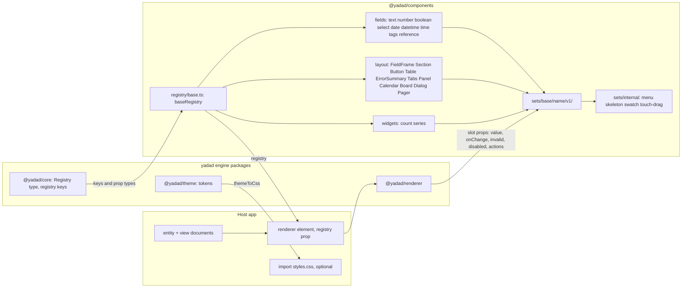
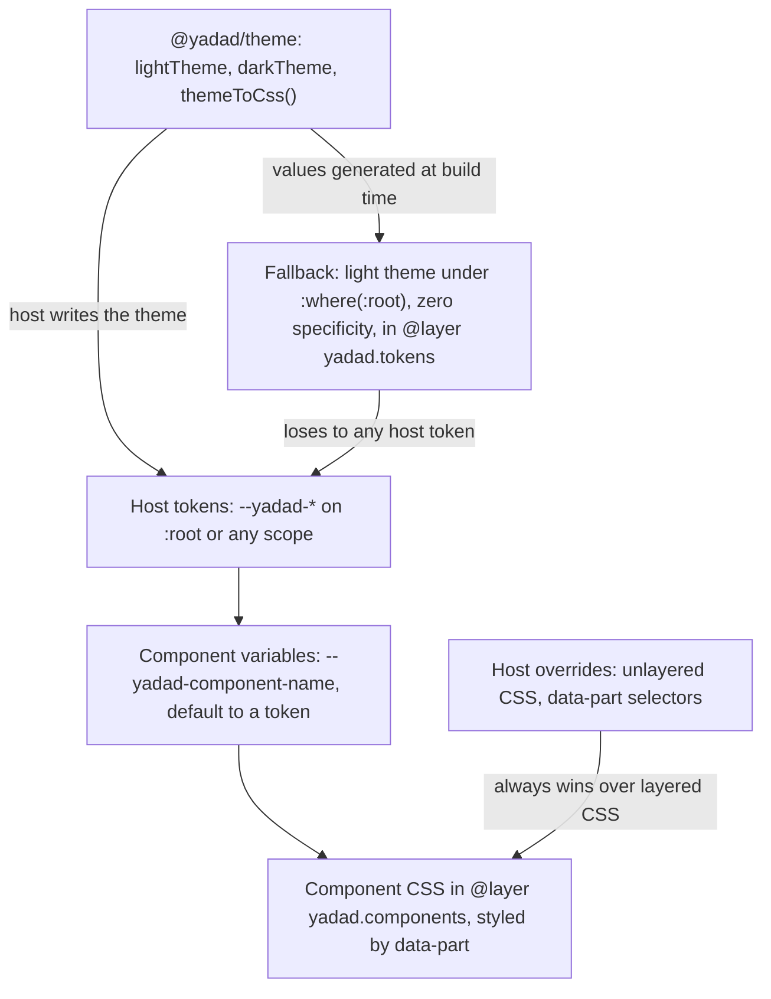
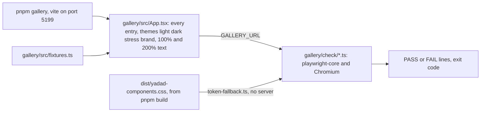
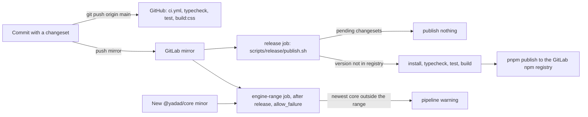

# Architecture

How `@yadad/components` is put together and how a host wires it in. The engine's own architecture (the document model, the `Registry` contract in section 9) lives in the [yadad repo](https://github.com/aggressive-stag/yadad/blob/main/ARCHITECTURE.md); this file covers only the component set. Security is in [docs/security.md](./docs/security.md).

All diagrams are Mermaid, so they render on GitHub and GitLab and diff in review. Each was checked against the source at commit `bbfc51e` on 2026-10-27.

## 1. How a host wires the set

The engine's registry keys come from `@yadad/core`. `registry/base.ts` maps every key to exactly one component version under `sets/base/<name>/v1/`. The host hands that registry to a renderer; the renderer decides what to draw and passes each component its slot props.

*How a host injects `baseRegistry` into the renderer and where slot props flow back to the version-1 components (checked against `registry/base.ts` at `bbfc51e`, 2026-10-27).*

The set imports only `react` and `@yadad/core`; there are no other runtime imports (`git grep` over `sets/` and `registry/`). `@yadad/core` is a peer dependency. `@yadad/renderer`, `@yadad/theme` and `@yadad/testing` are linked dev dependencies, used by tests and the gallery.

Versions sit side by side: a breaking change to a component arrives as a new `v2` folder, and switching is a one-line change in `registry/base.ts`.

## 2. Theming layers

Components read tokens and never hard-code a colour, length, radius or font (enforced by `scripts/theming.ts`, run as `scripts/theming.test.ts`). The pre-built CSS declares the layer order `yadad.tokens, yadad.components`, so unlayered host CSS always wins. [THEMING.md](./THEMING.md) is generated from the CSS; never hand-edit it.

*The token layers from `@yadad/theme` to host overrides (checked against `THEMING.md`, `scripts/theming.ts` and `scripts/token-fallback.ts` at `bbfc51e`, 2026-10-27).*

`scripts/token-fallback.ts` generates the fallback from `lightTheme`; `scripts/build-css.ts` emits `dist/yadad-components.css` plus one fragment per component in `dist/styles/`. Colour hints from documents are not applied as CSS: `paletteSlot()` maps a `#RRGGBB` value to a palette slot 0-7 and the component renders `data-slot`, which the CSS maps to a `--yadad-color-category-N` token.

## 3. Gallery and browser checks

`pnpm gallery` serves a page that renders every registry entry in every state (`gallery/src/App.tsx`, fixtures in `gallery/src/fixtures.ts`). The checks in `gallery/check/` drive Chromium through `playwright-core` against that page, or against the built CSS, and exit non-zero on failure. They are not part of `pnpm test` and are not published.

*The gallery and the browser checks that drive it (checked against `gallery/` and `gallery/check/` at `bbfc51e`, 2026-10-27).*

The checks are `composer-surfaces`, `contrast`, `done-toggle`, `pager-registry`, `phone-touch`, `select-labels-axe`, `slot-props`, `table-markup`, `tabs-keyboard`, `text-maxlength`, `text-multiline`, `time-tags-phone` and `token-fallback`; see [gallery/README.md](./gallery/README.md).

## 4. Release and peer-range policy

`peerDependencies["@yadad/core"]` is `>=0.10.0 <1.0.0`. A new core minor therefore needs no components release unless a feature needs it; the README Compatibility section lists the per-feature minimums. A core 1.0 is outside the range and needs a deliberate change here.

*From commit to published package, and the engine-range watchdog (checked against `.github/workflows/ci.yml`, `.gitlab-ci.yml` and `scripts/release/publish.sh` at `bbfc51e`, 2026-10-27).*

`pnpm changeset version` writes the version and `CHANGELOG.md`; the mirror's CI publishes any version the registry does not have yet, and publishes nothing while changesets are pending. The `engine-range` job runs `check:engine --install`, which proves the full gate against the newest published engine. On GitHub's public runners the registry is unreachable, so `check:engine` skips loudly there.
