# @yadad/components

The reference component set for [yadad](https://github.com/aggressive-stag/yadad), a schema-driven React engine for forms, tables, calendars, boards and dashboards. It is a styled, themeable, accessible implementation of the engine's `Registry` contract: install it, hand it to the renderer, and your entity and view documents render with real inputs, a sortable table, a calendar, a board, tabs and panels.

You do not have to use it. The engine only asks for something that satisfies its `Registry` type, so you can swap this set for your own, or replace individual entries.

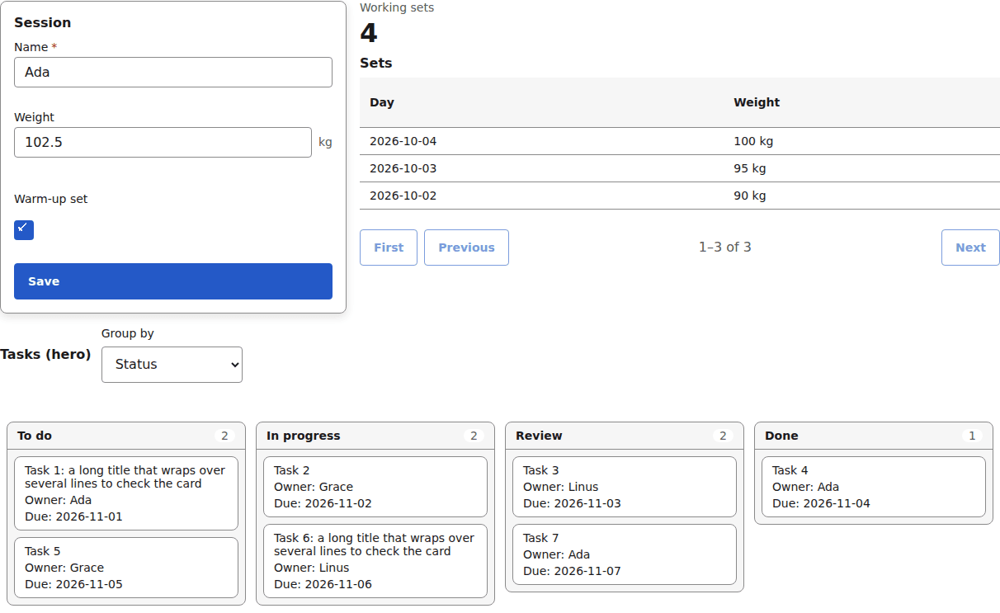

*The set composed together: fields in a panel, a table with its pager, a board — one page, one theme. The same page under the dark theme:*

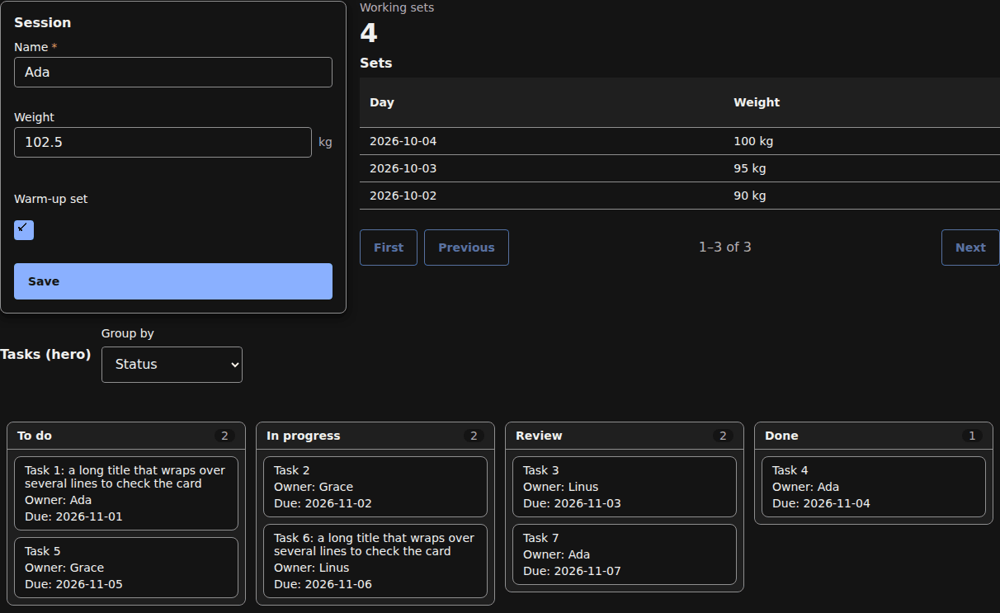

Every picture in this README and in [docs/components/](./docs/components/) is generated from the gallery by `pnpm docs:shots` (`gallery/shoot.ts`) over the fictional fixtures — see [docs/assets/screens/README.md](./docs/assets/screens/README.md).

## Install

Packages are published to the project's GitLab npm registry, not to npmjs.com. Point the `@yadad` scope at the registry's instance-level npm endpoint, where `<gitlab-host>` is the GitLab instance that hosts the project. One entry serves `@yadad/components` and every engine package; a project-scoped URL would serve only one repo's packages. Add an auth token for that host if the instance requires one.

```ini
# .npmrc
@yadad:registry=https://<gitlab-host>/api/v4/packages/npm/
```

```sh
pnpm add @yadad/components @yadad/core @yadad/renderer @yadad/theme
```

Peer dependencies: `react` `^19.3.0` and `@yadad/core` (see [Compatibility](#compatibility)).

## Usage

Import the registry and the stylesheet, then pass the registry to a renderer:

```tsx
import { FormRenderer } from "@yadad/renderer";
import { baseRegistry } from "@yadad/components";
import "@yadad/components/styles.css";

export function CustomerForm({ entity, view, dataSources }) {
  return (
    <FormRenderer
      entity={entity}
      view={view}
      registry={baseRegistry}
      dataSources={dataSources}
    />
  );
}
```

`baseRegistry` is a `Registry<ReactNode>`. The same registry works with `TableRenderer`, `CalendarRenderer`, `BoardRenderer` and `DashboardRenderer`. The stylesheet is optional: skip it and style the `data-part` hooks yourself.

## What is included

- **Field types** (each an `Input` and a read-only `Display`): `text`, `number`, `boolean`, `select`, `date`, `datetime`, `time`, `tags`, `reference`. The `text` Display also draws word-level compare marks (`<ins>` / `<del>` with screen-reader `added:` / `removed:` prefixes) when the renderer passes a `diff`; the root carries `data-raw-before` / `data-raw-after`, the unsplit old and new text. The `datetime` and `time` Displays are `<time>` elements carrying the stored instant / `HH:MM`. `tags` (RFC 0008 item 15) is a chip editor: type-and-Enter adds, each chip removes, Backspace on the empty field removes the last. Select options render their labels and colour dots when the document carries them (RFC 0008 item 10).
- **Layout:** `FieldFrame` (label, required marker and errors around any input), `Section`, `Panel`, `Tabs`, `Button` (also renders the engine's `tone` and — for saved-filter chips, RFC 0009 item 5 — `pressed`: the selected chip fills from the accent and announces `aria-pressed`), `ErrorSummary`, `Dialog` (modal: native `showModal` with an `open`-attribute fallback, focus trap, background inert, focus returned to the opener; fills the engine's `layout.Dialog` key), `Table`, `Pager` (fills the engine's `layout.Pager` key, RFC 0008 item 11: the paged table's Previous/Next with the current page marked typographically, never colour alone), `Calendar` (month and week grid of entries, with a phone agenda, drag and a "Move to day…" action) and `Board` (cards in columns, one column per value of a field, with a group-by picker, drag between columns, a "Move to…" action for keyboard and touch, a scrolling card list per column, and on a phone one column at a time with snap scrolling; the engine's `layout.Board` registry key). `Calendar` fills the engine's `layout.Calendar` key.
- **RFC 0009 chrome** (the renderer draws these; this set styles them): the saved-filter chip row wraps instead of side-scrolling at phone width; `repeat: "batch"` composer rows sit on a token hairline with the "+ another" controls under the last row; a sub-record checklist row that is ticked strikes through in muted ink — the tick itself stays the primary signal.
- **Table:** sortable column headers, and on a narrow container it switches to a stacked layout where each row becomes a card with a label on every cell.
- **Record actions (RFC 0007):** tables, board cards and calendar entries render their record's actions as buttons (`tone` neutral/danger, `disabled` with a "Working…" live region while the record has an action in flight); two or more collapse into an "Actions…" menu where the surface has no room for buttons (tables at phone width, boards and calendars always). The renderer owns the confirm/input dialog; it is this set's `Dialog`.
- **Widgets:** `count` and `series` (one measure per group of a table view — the engine computes the groups, the component draws them; `display: "table"`, `"bar"` and `"line"` — the charts are inline SVG over the same data, keyboard-operable, with the table kept as the accessible data).

| [text](./docs/components/text.md) | [number](./docs/components/number.md) | [boolean](./docs/components/boolean.md) | [select](./docs/components/select.md) |
| --- | --- | --- | --- |
| [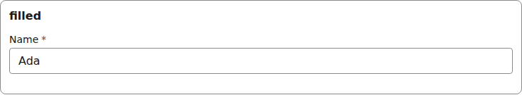](./docs/components/text.md) | [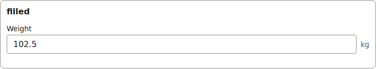](./docs/components/number.md) | [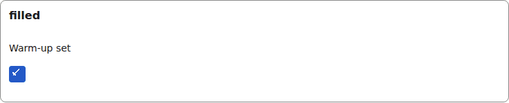](./docs/components/boolean.md) | [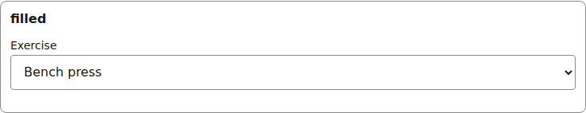](./docs/components/select.md) |

| [date](./docs/components/date.md) | [datetime](./docs/components/datetime.md) | [time](./docs/components/time.md) | [tags](./docs/components/tags.md) |
| --- | --- | --- | --- |
| [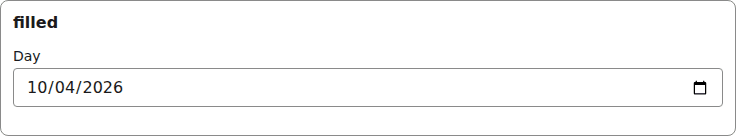](./docs/components/date.md) | [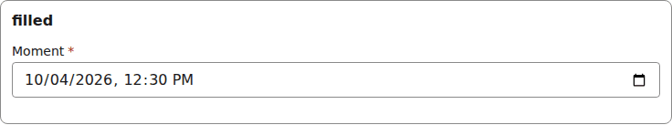](./docs/components/datetime.md) | [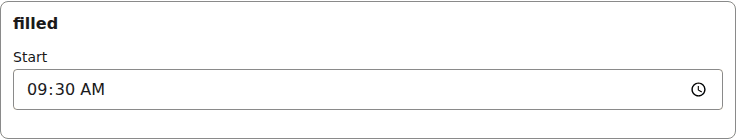](./docs/components/time.md) | [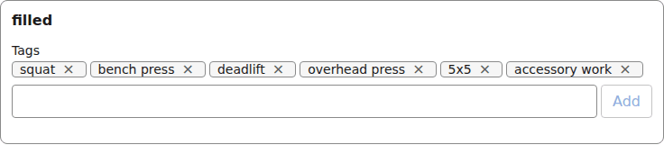](./docs/components/tags.md) |

| [reference](./docs/components/reference.md) | [FieldFrame](./docs/components/field-frame.md) | [Section](./docs/components/section.md) | [Panel](./docs/components/panel.md) |
| --- | --- | --- | --- |
| [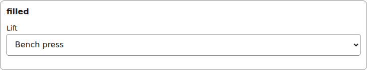](./docs/components/reference.md) | [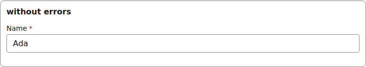](./docs/components/field-frame.md) | [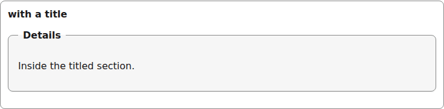](./docs/components/section.md) | [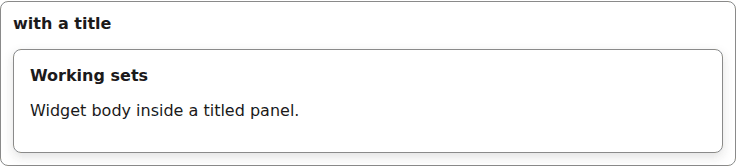](./docs/components/panel.md) |

| [Tabs](./docs/components/tabs.md) | [Button](./docs/components/button.md) | [ErrorSummary](./docs/components/error-summary.md) | [Dialog](./docs/components/dialog.md) |
| --- | --- | --- | --- |
| [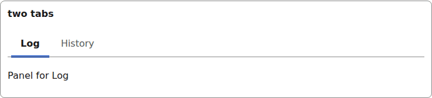](./docs/components/tabs.md) | [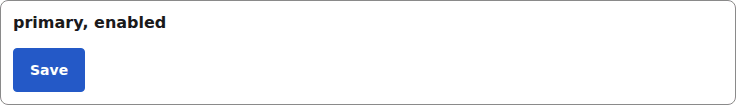](./docs/components/button.md) | [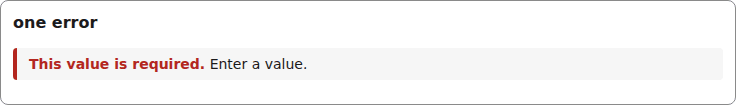](./docs/components/error-summary.md) | [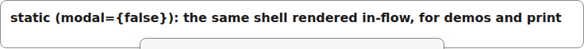](./docs/components/dialog.md) |

| [Table](./docs/components/table.md) | [Pager](./docs/components/pager.md) | [Calendar](./docs/components/calendar.md) | [Board](./docs/components/board.md) |
| --- | --- | --- | --- |
| [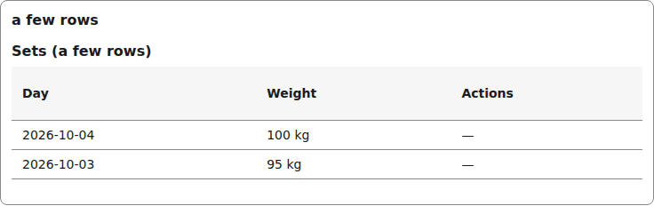](./docs/components/table.md) | [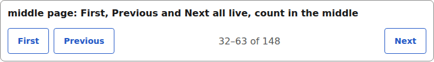](./docs/components/pager.md) | [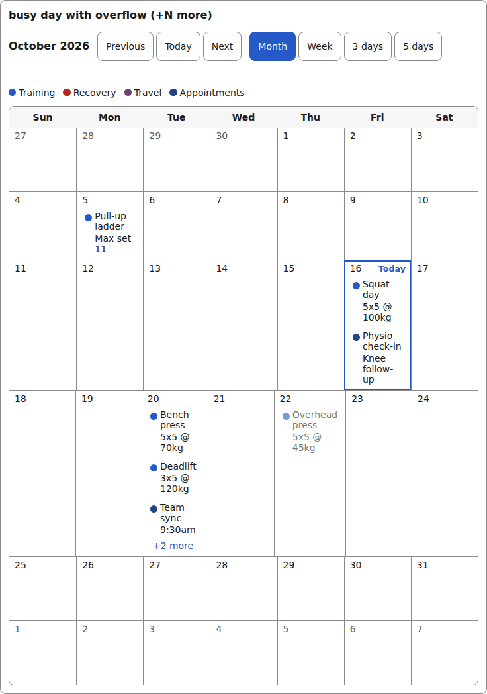](./docs/components/calendar.md) | [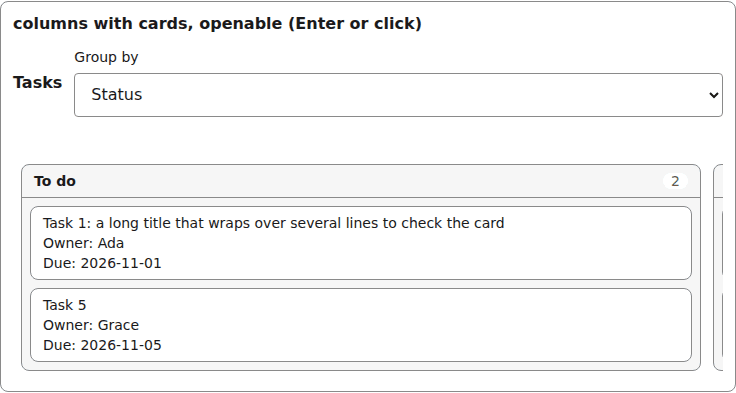](./docs/components/board.md) |

| [count](./docs/components/count.md) | [series](./docs/components/series.md) | [RFC 0009 chrome](./docs/components/composer.md) | [Check (internal)](./docs/components/check.md) |
| --- | --- | --- | --- |
| [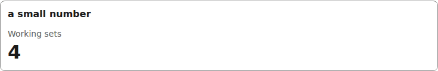](./docs/components/count.md) | [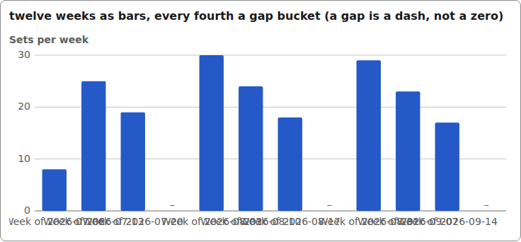](./docs/components/series.md) | [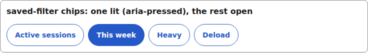](./docs/components/composer.md) | [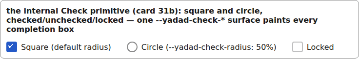](./docs/components/check.md) |

Each component lives under `sets/base/<name>/v1/`. Versions sit side by side, so a future breaking change arrives as a new `v2` rather than an in-place edit. `Check` is the internal completion box every checkbox in the set is built on; it lives under `sets/internal/check/v1/` and is not in the registry.

## Theming

Everything is styled through a public surface, so you never fork a component to change its look:

1. **Tokens.** Set the `--yadad-*` custom properties from `@yadad/theme` (colors, spacing, radii, fonts, and the optional `--yadad-shadow-sm` / `--yadad-shadow-md`) on `:root` or any scope. `lightTheme`, `darkTheme` and `themeToCss()` are exported by `@yadad/theme`.
2. **Per-component variables.** Each component exposes variables such as `--yadad-text-border` that default to a token, so you can change one thing and inherit the rest.
3. **`data-part` hooks.** Every rendered element has a stable `data-part` (`input`, `label`, `error`, `header`, ...) and each component root a `data-yadad="<type>"` marker. Renaming a part is a breaking change.

All component CSS is in `@layer yadad.components`, so unlayered host CSS always wins without `!important`. Components contain no hard-coded colors, lengths, radii or fonts. The complete list of tokens, parts and variables is in [THEMING.md](./THEMING.md), which is generated from the CSS and kept in sync by the test suite.

## Accessibility and touch

- Every interactive element has a visible `:focus-visible` ring.
- Each registry entry is checked with axe and the engine's contract test kit (renders with fixture options, emits the correct JSON type on change, shows its error).
- Tabs are keyboard operable, and a long tab list scrolls inside its own container.
- On a phone, buttons, the checkbox label, sortable headers, tabs and pickers have a tap target of at least 44x44 CSS px, tied to your spacing tokens so it scales with text size. Each has a `--yadad-*-tap` variable you can override.
- On a touch device (`pointer: coarse`) every text-entry control (text, number, date, datetime, time, select, tags, the calendar and board inline inputs) renders at 16px or larger whatever your theme's `--yadad-font-size-md` is, so iOS Safari does not zoom on focus. A larger theme size is kept. To go smaller you must override the control's `--yadad-*-touch-font-size` variable on purpose, and iOS will then zoom on focus. The calendar's "Move to day..." and "+N more" links, its entries, and every other button measure at least 44px tall, and the done checkbox box draws at 20px with its label as the 44px target. Desktop (`pointer: fine`) sizes are unchanged.
- **Two shared touch variables move every control at once.** Each `--yadad-*-tap` defaults through `--yadad-touch-tap` and each `--yadad-*-touch-font-size` defaults through `--yadad-touch-font-size`, both before falling back to the token-derived size. Set the shared variable once (on `:root` or any ancestor) to retune every thumb target or every coarse-pointer input font in every component; the per-component variable still wins for its own component, because it is the outer `var()`. Apps that set the per-component variables today are unaffected.
- The page does not scroll sideways: tables scroll or stack inside their container and long text wraps. The one exception is a browser's native date control, whose minimum width CSS cannot shrink.

## Gallery

```sh
pnpm gallery
```

serves a page that renders every component in every state, with light, dark, stress and brand themes and 100% / 200% text toggles. It is the quickest way to see what you are getting and to try a theme.

## Compatibility

Works with every `@yadad/core` 0.x from 0.10.0 (the `peerDependencies` range is `>=0.10.0 <1.0.0`), because core minors are additive; a new core minor needs no components release unless a feature listed here needs it. The newest features ask for their engine: `time`/`tags` fields, the `layout.Pager` key and the pressed saved-filter chip need `@yadad/core` / `@yadad/renderer` 0.15 / 0.14 (specVersion 8). The option and column colour palette, the calendar legend colours, the quick-filter text placeholder, the page notice and the datetime `minLocal`/`maxLocal` limits come with `@yadad/core` / `@yadad/renderer` 0.16 (RFC 0010); on an older engine they simply do not appear. The confirm dialog's subject line comes with `@yadad/core` / `@yadad/renderer` 0.17 (RFC 0011). The board's hidden no-value column (a move target in "Move to…" and a drop target while dragging) comes with `@yadad/core` 0.17.1 / `@yadad/renderer` 0.18.1. React 19 is required. Node 22.18 or newer is needed to build from source (the build scripts are TypeScript that Node runs directly).

## Development

```sh
pnpm install
pnpm gallery     # see every component
pnpm test        # contract kit, axe, theming guardrails
pnpm build       # type declarations and dist/yadad-components.css
```

How the set is put together is in [ARCHITECTURE.md](./ARCHITECTURE.md), the component pages with a picture of every state are in [docs/components/](./docs/components/), and its security notes in [docs/security.md](./docs/security.md). Contribution rules, releasing and the browser checks are in [AGENTS.md](./AGENTS.md); attribution for adapted code is in [UPSTREAM.md](./UPSTREAM.md); versions are listed in [CHANGELOG.md](./CHANGELOG.md).

## Links

- Engine: [yadad](https://github.com/aggressive-stag/yadad) and its [ARCHITECTURE.md](https://github.com/aggressive-stag/yadad/blob/main/ARCHITECTURE.md) (the Registry contract is section 9)
- Theme tokens: `@yadad/theme`
