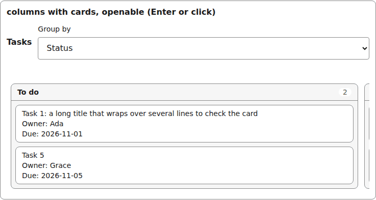
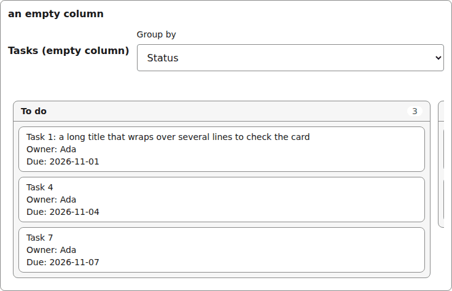
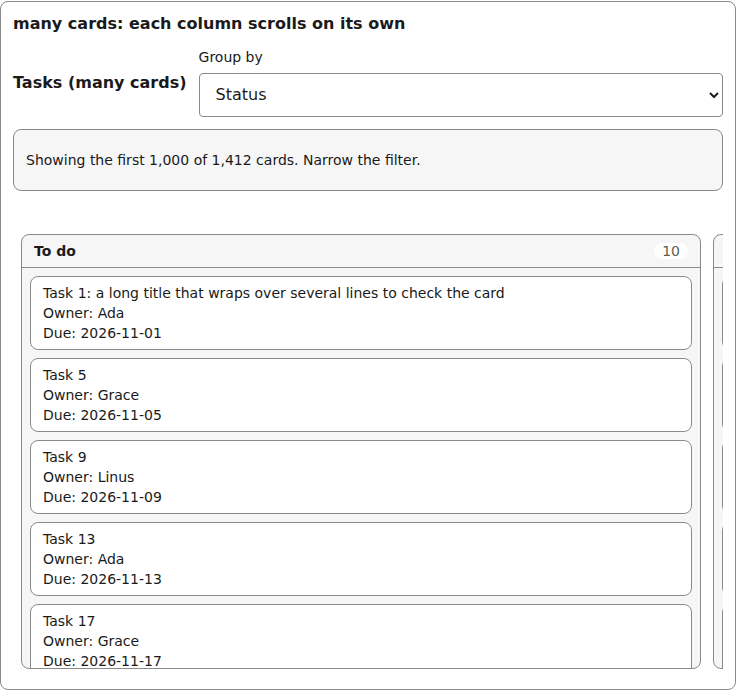
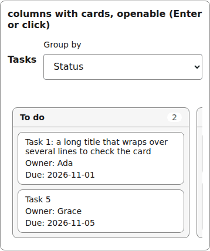
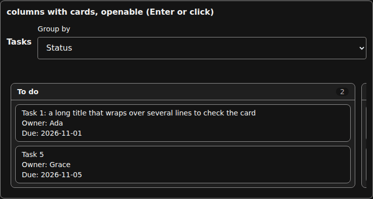

# board

Cards grouped into one column per value of a field, with a group-by picker. On a phone the columns snap-scroll one at a time; each column's card list scrolls on its own.

## Columns with cards

```tsx
const STATUS = ["To do", "In progress", "Review", "Done"];
const card = (n: number, title: string, owner: string, due: string): BoardCard<ReactNode> => ({
  id: `r${n}`, label: `${title}, Owner: ${owner}, Due: ${due}`, movable: false, pending: false,
  content: (<><span>{title}</span><span>Owner: {owner}</span><span>Due: {due}</span></>),
});
const columns = STATUS.map((name) => ({
  id: `v:${name}`, label: name, count: 2, droppable: true,
  cards: [card(1, "Task 1", "Ada", "2026-11-01"), card(5, "Task 5", "Grace", "2026-11-05")],
}));

<Board label="Tasks"
  groupChoices={[{ field: "status", label: "Status" }, { field: "owner", label: "Owner" }]}
  groupField="status"
  columns={columns}
  loading={false}
  onGroupBy={() => {}}
  onOpenCard={() => {}}
/>
```



*the board with four status columns, cards carrying title, owner and due lines, and the group-by picker (1280px, light).*

## An empty column

```tsx
const columns = [/* three columns with cards */, { id: "v:done", label: "Done", count: 0, droppable: true, cards: [] }];
```



*the board with an empty column between two full ones (1280px, light).*

## Many cards

Forty cards spread over the columns plus eight extra columns; every column's list scrolls independently.



*the board with many cards: a tall scrollable column, the group-by picker above (1280px, light).*

## On a phone

The same board in a 390px viewport: one column at a time with snap scrolling.



*the board at phone width: one column fills the width (390px, phone).*

## Dark



*the board in the dark theme (1280px, light).*


## Theming

- `--yadad-board-font-family` — font stack; default: token `--yadad-font-family` (base font stack)
- `--yadad-board-font-size` — font size; default: token `--yadad-font-size-sm` (small text (labels, secondary, table cells))
- `--yadad-board-color` — foreground color; default: token `--yadad-color-text` (main text color)
- `--yadad-board-title-size` — board title font size; default: token `--yadad-font-size-md` (base text (inputs, body, tab labels))
- `--yadad-board-notice-border` — notice border color; default: token `--yadad-color-border` (borders and dividers)
- `--yadad-board-radius` — corner radius; default: token `--yadad-radius-md` (medium corner radius (cards, panels, sections))
- `--yadad-board-notice-background` — notice background; default: token `--yadad-color-surface` (raised surface (sections, panels, table headers))
- `--yadad-board-status-color` — live-region (status) text color; default: token `--yadad-color-text` (main text color)
- `--yadad-board-status-accent` — live-region leading bar color; default: token `--yadad-color-accent` (brand / primary accent — links, focus ring, selected state)
- `--yadad-board-status-background` — live-region background; default: token `--yadad-color-surface` (raised surface (sections, panels, table headers))
- `--yadad-board-gap` — gap between parts; default: token `--yadad-space-3` (spacing scale, step 3)
- `--yadad-board-column-width` — inline size of a column; default: `calc(var(--yadad-space-4) * 18)` (token-derived: `--yadad-space-4`)
- `--yadad-board-border` — border color; default: token `--yadad-color-border` (borders and dividers)
- `--yadad-board-column-background` — column background; default: token `--yadad-color-surface` (raised surface (sections, panels, table headers))
- `--yadad-board-radius-full` — count badge corner radius; default: token `--yadad-radius-md` (medium corner radius (cards, panels, sections))
- `--yadad-board-count-background` — column count badge background; default: token `--yadad-color-background` (page and control background)
- `--yadad-board-count-color` — column count and empty-column text color; default: token `--yadad-color-text-muted` (secondary / muted text (labels, captions, empty states))
- `--yadad-board-column-max-height` — tallest a column's card list gets before it scrolls; default: `calc(var(--yadad-space-4) * 30)` (token-derived: `--yadad-space-4`)
- `--yadad-board-card-background` — card background; default: token `--yadad-color-background` (page and control background)
- `--yadad-board-card-hover` — background of an openable card under the pointer; default: token `--yadad-color-surface` (raised surface (sections, panels, table headers))
- `--yadad-board-focus` — focus-ring color; default: token `--yadad-color-accent` (brand / primary accent — links, focus ring, selected state)
- `--yadad-board-tap` — minimum height of the move buttons (the tap target on a phone); default: `var(--yadad-touch-tap, calc(var(--yadad-space-4) * 2 + var(--yadad-space-3)))` (token-derived: `--yadad-space-3`, `--yadad-space-4`)
- `--yadad-board-link` — move button text color; default: token `--yadad-color-accent` (brand / primary accent — links, focus ring, selected state)
- `--yadad-board-done-color` — completion checkbox label text color; default: token `--yadad-color-text` (main text color)
- `--yadad-board-checkbox-size` — DEPRECATED (card 31c): alias of `--yadad-check-size` on the board's done box; set `--yadad-check-size` instead (removal no earlier than the next major); default: `var(--yadad-check-size, calc(var(--yadad-space-4) + var(--yadad-space-1) + var(--yadad-focus-ring-width)))` (token-derived: `--yadad-focus-ring-width`, `--yadad-space-1`, `--yadad-space-4`)
- `--yadad-board-done-accent` — DEPRECATED (card 31c): alias of `--yadad-check-on` on the board's done box; set `--yadad-check-on` instead (removal no earlier than the next major); default: `var(--yadad-check-on, var(--yadad-color-accent))` (token-derived: `--yadad-color-accent`)
- `--yadad-board-actions-border` — record-action button border color (danger actions use the danger color for both); default: token `--yadad-color-border` (borders and dividers)
- `--yadad-board-actions-link` — record-action button text color; default: token `--yadad-color-accent` (brand / primary accent — links, focus ring, selected state)
- `--yadad-board-actions-focus` — record-action button keyboard focus-ring color; default: token `--yadad-color-accent` (brand / primary accent — links, focus ring, selected state)
- `--yadad-board-actions-danger` — record-action button color for tone=danger (text and border); default: token `--yadad-color-danger` (error / danger text and borders)
- `--yadad-board-actions-disabled-opacity` — opacity of a record-action button while a record's action is in flight; default: `0.6`
- `--yadad-board-drop-target` — outline color of the column a dragged card can drop on; default: token `--yadad-color-accent` (brand / primary accent — links, focus ring, selected state)
- `--yadad-board-drop-background` — background of the column a dragged card is over; default: token `--yadad-color-background` (page and control background)
- `--yadad-board-phone-column-max-height` — tallest a column's card list gets before it scrolls on a phone; default: `calc(var(--yadad-space-4) * 24)` (token-derived: `--yadad-space-4`)
- `--yadad-board-hidden-column-width` — width of the slim drop target for the hidden no-value column shown while a card is dragged; default: `calc(var(--yadad-space-4) * 8)` (token-derived: `--yadad-space-4`)
- `--yadad-board-hidden-column-height` — minimum height of that drop target; default: `calc(var(--yadad-space-4) * 6)` (token-derived: `--yadad-space-4`)
- `--yadad-board-move-panel-max-height` — tallest the "Move to…" panel gets before it scrolls inside the column (keeps Cancel reachable); default: `calc(var(--yadad-space-4) * 20)` (token-derived: `--yadad-space-4`)
- `--yadad-board-touch-font-size` — input font size under a coarse pointer; defaults to the larger of 1rem and the theme's font-size-md, so it never drops below 16px. Set it smaller only on purpose: iOS then zooms on focus; default: `var(--yadad-touch-font-size, max(var(--yadad-space-4), var(--yadad-font-size-md)))` (token-derived: `--yadad-font-size-md`, `--yadad-space-4`)

Before (the pictures above) and after one host override:

```css
[data-yadad=board] { --yadad-board-radius: 0px; }
```


*the board after a host override squaring off --yadad-board-radius (1280px, light).*
