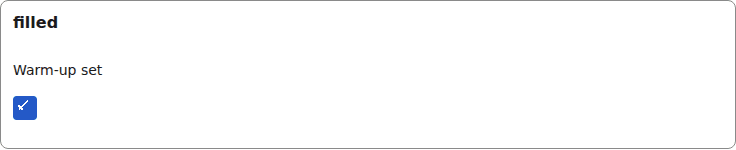
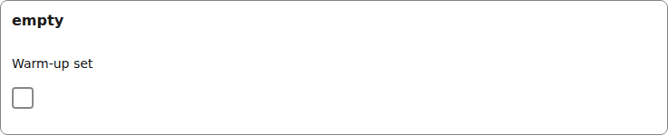
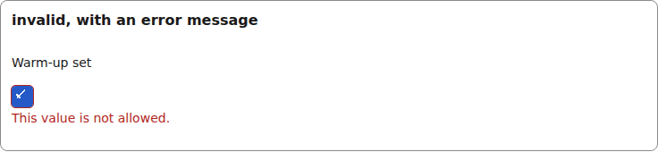
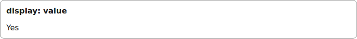
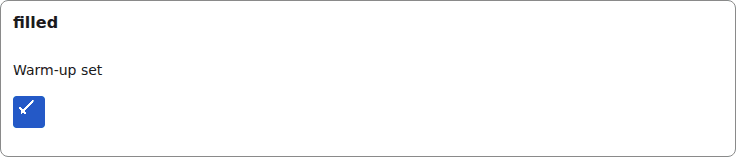

# boolean

A checkbox built on the internal [Check](./check.md) primitive; the label is the tap target.

Registry entry `fields.boolean` in `registry/base.ts` pairs an `Input` with a read-only `Display`.

## Input

The renderer wraps each Input in [FieldFrame](./field-frame.md) (label, required marker, errors):

```tsx
<BooleanInput
  inputId="g-x"
  field={{ id: "warmup", type: "boolean", label: "Warm-up set" }}
  value={true}
  onChange={() => {}}
  invalid={false}
/>
```



*the boolean input with a value (1280px, light).*

```tsx
<BooleanInput
  inputId="g-x"
  field={{ id: "warmup", type: "boolean", label: "Warm-up set" }}
  value={undefined}
  onChange={() => {}}
  invalid={false}
/>
```



*the boolean input with no value (1280px, light).*

```tsx
<BooleanInput
  inputId="g-x"
  field={{ id: "warmup", type: "boolean", label: "Warm-up set" }}
  value={true}
  onChange={() => {}}
  invalid={true}
  describedBy="g-x-errors"  // only when invalid
/>
// and FieldFrame errors={[invalidError("/warmup", "This value is not allowed.")]}
```



*the boolean input with a validation error (1280px, light).*

## Display

```tsx
<BooleanDisplay field={{ id: "warmup", type: "boolean", label: "Warm-up set" }}
  value={true}
/>
```



*the boolean Display with a value (1280px, light).*


## Theming

- `--yadad-boolean-size` — box size; when unset the box follows `--yadad-check-size`, and when neither is set it keeps this component's thumb-sized default (a checklist's box is the row's tap target); default: `var(--yadad-check-size, calc(var(--yadad-space-4) * 1.5))` (token-derived: `--yadad-space-4`)
- `--yadad-boolean-accent` — accent color; default: `var(--yadad-check-on, var(--yadad-color-accent))` (token-derived: `--yadad-color-accent`)
- `--yadad-boolean-focus` — focus-ring color; default: `var(--yadad-check-focus, var(--yadad-color-accent))` (token-derived: `--yadad-color-accent`)
- `--yadad-boolean-border-invalid` — border color when invalid; default: token `--yadad-color-danger` (error / danger text and borders)

Before (the picture above) and after one host override. Host CSS is unlayered, so it wins over the component layer without `!important`:

```css
[data-yadad=boolean] { --yadad-boolean-size: 2rem; }
```



*the boolean input after a host override of its size variables (1280px, light).*
