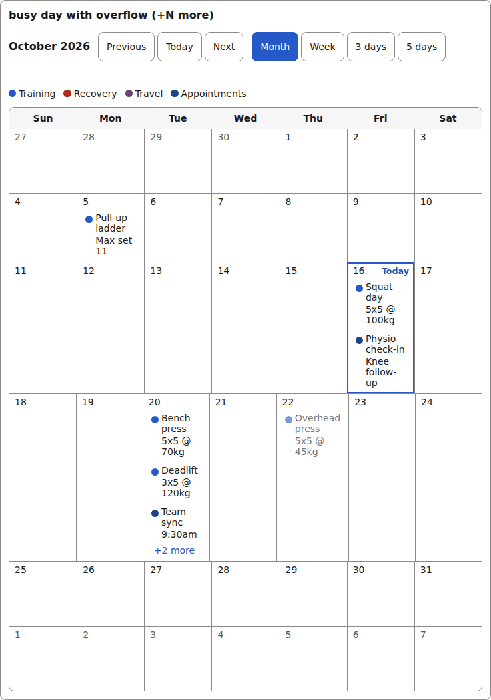
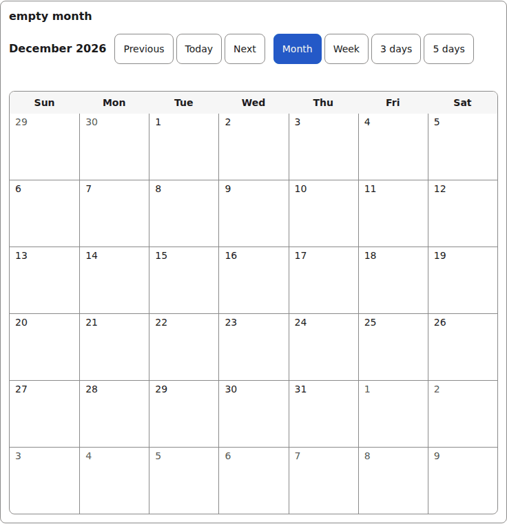
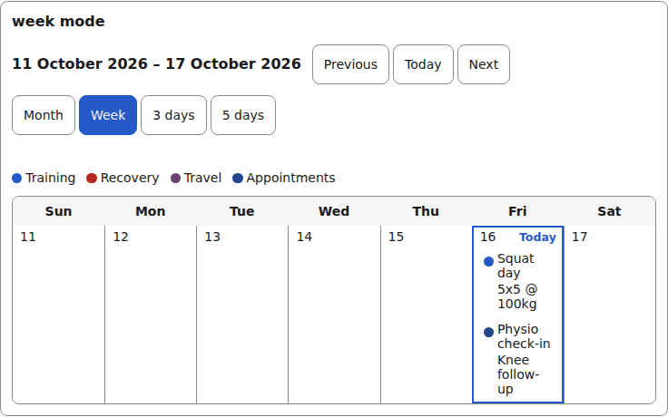
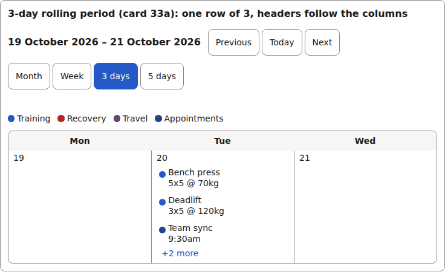
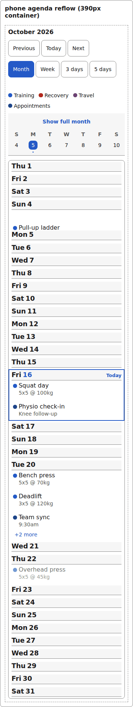
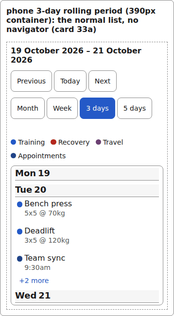
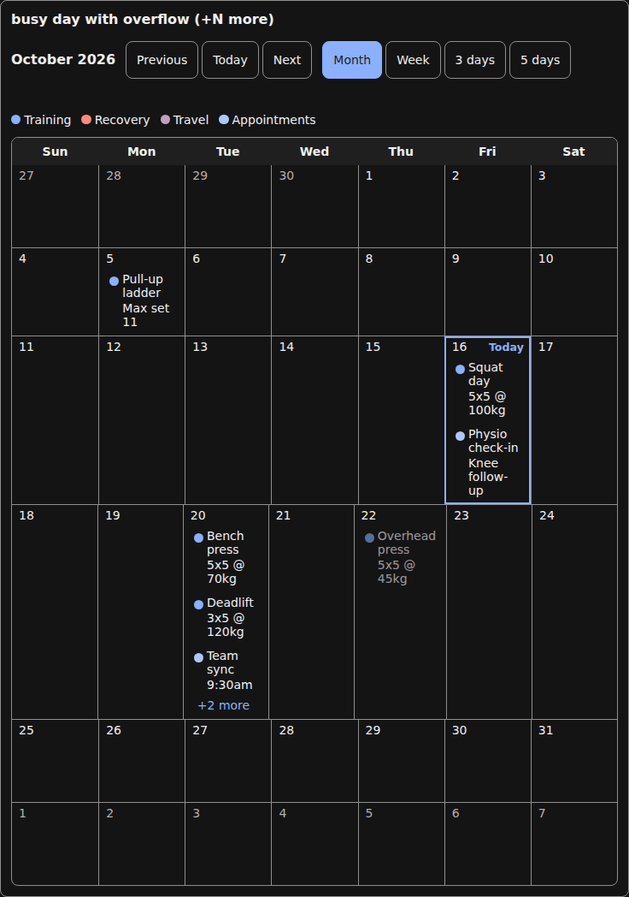
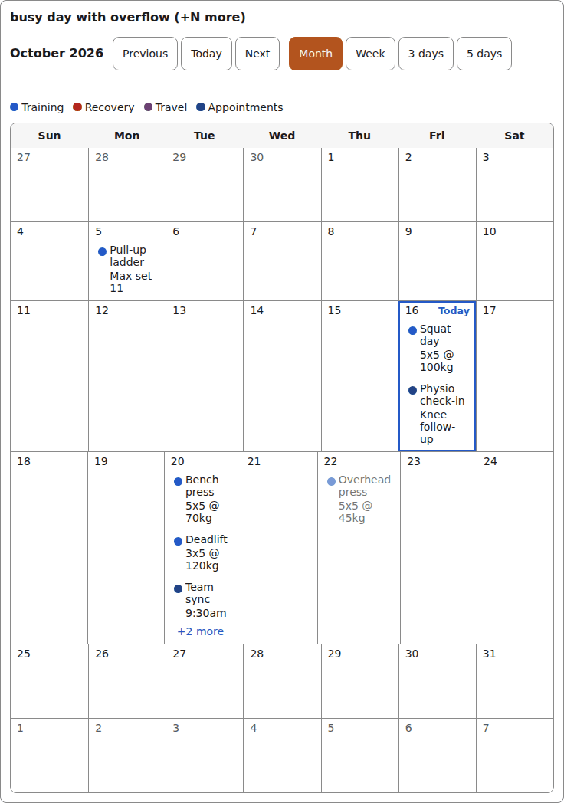

# calendar

A month or week grid of entries with a mode switch (month / week / 3 days / 5 days), a pinned week strip on phones, a day agenda list, a legend, and optional drag and "Move to day…" wiring the renderer supplies.

## Month

```tsx
const entries = [
  { id: "e1", date: "2026-10-16", title: "Squat day", detail: "5x5 @ 100kg", slot: 0, movable: true },
  { id: "e2", date: "2026-10-16", title: "Physio check-in", detail: "Knee follow-up", slot: 3, movable: true },
  // ...7 fixture entries over 2026-10-05..2026-10-22, five on the 20th...
] as const;

<Calendar label="Training" title="October 2026" mode="month"
  modes={[{ mode: "month", label: "Month" }, { mode: "week", label: "Week" },
           { mode: "3day", label: "3 days" }, { mode: "5day", label: "5 days" }]}
  weekdays={calendarWeekdays} days={days /* CalendarDay[] built around the anchor */}
  legend={[...calendarLegend]} loading={false}
  onModeChange={() => {}} onPrevious={() => {}} onNext={() => {}} onToday={() => {}}
/>
```



*the calendar month grid: days with entry chips, a busy day capped at +N more, the agenda list below (1280px, light).*

```tsx
const days = monthGridDates("2026-12-01").map((date) => ({ date, entries: [] }));  // an empty month
```



*the calendar with an empty month: the grid and navigator, no entries (1280px, light).*

## Week and rolling periods



*the calendar in week mode: one row of days with the full entry list below (1280px, light).*



*the calendar in 3-day mode: three day columns, headers follow the columns (1280px, light).*

## On a phone

In a 390px container the month collapses to a pinned week strip and the entries read as an agenda list.



*the calendar on a phone: the month's entries as an agenda list under the strip (390px, phone).*



*the calendar on a phone in 3-day mode at 390px (390px, phone).*

## Dark



*the calendar month in the dark theme (1280px, light).*


## Theming

- `--yadad-calendar-font-family` — font stack; default: token `--yadad-font-family` (base font stack)
- `--yadad-calendar-font-size` — font size; default: token `--yadad-font-size-sm` (small text (labels, secondary, table cells))
- `--yadad-calendar-color` — foreground color; default: token `--yadad-color-text` (main text color)
- `--yadad-calendar-title-size` — title font size; default: token `--yadad-font-size-md` (base text (inputs, body, tab labels))
- `--yadad-calendar-tap` — phone navigator only: the minimum height of the grabber (navigator-toggle). Default var(--yadad-touch-tap) (2.75rem / 44px). The day buttons read calendar-nav-tap; this is the grabber's own floor, so a host that wants a taller map and a slimmer grabber (or the reverse) has two knobs, not one; default: `var(--yadad-touch-tap, calc(var(--yadad-space-4) * 2 + var(--yadad-space-3)))` (token-derived: `--yadad-space-3`, `--yadad-space-4`)
- `--yadad-calendar-border` — border color; default: token `--yadad-color-border` (borders and dividers)
- `--yadad-calendar-radius` — corner radius; default: token `--yadad-radius-md` (medium corner radius (cards, panels, sections))
- `--yadad-calendar-selected-background` — selected mode-switch button background; default: token `--yadad-color-accent` (brand / primary accent — links, focus ring, selected state)
- `--yadad-calendar-selected-color` — selected mode-switch button text color; default: token `--yadad-color-surface` (raised surface (sections, panels, table headers))
- `--yadad-calendar-focus` — focus-ring color; default: token `--yadad-color-accent` (brand / primary accent — links, focus ring, selected state)
- `--yadad-calendar-notice-border` — notice border color; default: token `--yadad-color-border` (borders and dividers)
- `--yadad-calendar-notice-background` — notice background; default: token `--yadad-color-surface` (raised surface (sections, panels, table headers))
- `--yadad-calendar-status-color` — live-region (status) text color; default: token `--yadad-color-text` (main text color)
- `--yadad-calendar-status-accent` — live-region leading bar color; default: token `--yadad-color-accent` (brand / primary accent — links, focus ring, selected state)
- `--yadad-calendar-status-background` — live-region background; default: token `--yadad-color-surface` (raised surface (sections, panels, table headers))
- `--yadad-calendar-radius-full` — legend/entry swatch corner radius (circular); default: `50%`
- `--yadad-calendar-slot-0` — colour slot 0 (categorical entry/legend color); default: no default — the host must set it
- `--yadad-calendar-slot-1` — colour slot 1 (categorical entry/legend color); default: no default — the host must set it
- `--yadad-calendar-slot-2` — colour slot 2 (categorical entry/legend color); default: no default — the host must set it
- `--yadad-calendar-slot-3` — colour slot 3 (categorical entry/legend color); default: no default — the host must set it
- `--yadad-calendar-slot-4` — colour slot 4 (categorical entry/legend color); default: no default — the host must set it
- `--yadad-calendar-slot-5` — colour slot 5 (categorical entry/legend color); default: no default — the host must set it
- `--yadad-calendar-slot-6` — colour slot 6 (categorical entry/legend color); default: no default — the host must set it
- `--yadad-calendar-slot-7` — colour slot 7 (categorical entry/legend color); default: no default — the host must set it
- `--yadad-calendar-columns` — the grid's column count, as the number `repeat()` consumes. month/week never set it and the CSS fallback is 7; a rolling "<n>day" period (card 33a) sets it inline from its row length — set it yourself only to force an odd mode's column count; default: `7`
- `--yadad-calendar-header-background` — header background; default: token `--yadad-color-surface` (raised surface (sections, panels, table headers))
- `--yadad-calendar-day-min` — minimum day-cell block size; default: `calc(var(--yadad-space-4) * 6)` (token-derived: `--yadad-space-4`)
- `--yadad-calendar-outside-color` — text color of a day outside the current month; default: token `--yadad-color-text-muted` (secondary / muted text (labels, captions, empty states))
- `--yadad-calendar-outside-background` — background of a day outside the current month; default: `transparent`
- `--yadad-calendar-drop-target` — drag drop-target outline color; default: token `--yadad-color-accent` (brand / primary accent — links, focus ring, selected state)
- `--yadad-calendar-drop-target-background` — drag drop-target background; default: `var(--yadad-calendar-header-background, var(--yadad-color-surface))` (token-derived: `--yadad-color-surface`)
- `--yadad-calendar-today` — today ring and badge color; default: token `--yadad-color-accent` (brand / primary accent — links, focus ring, selected state)
- `--yadad-calendar-done-color` — completion checkbox label text color; default: token `--yadad-color-text` (main text color)
- `--yadad-calendar-checkbox-size` — DEPRECATED (card 31b): alias of `--yadad-check-size` on the calendar's done box; set `--yadad-check-size` instead (removal no earlier than the next major); default: `var(--yadad-check-size, calc(var(--yadad-space-4) + var(--yadad-space-1) + var(--yadad-focus-ring-width)))` (token-derived: `--yadad-focus-ring-width`, `--yadad-space-1`, `--yadad-space-4`)
- `--yadad-calendar-done-accent` — DEPRECATED (card 31b): alias of `--yadad-check-on` on the calendar's done box; set `--yadad-check-on` instead (removal no earlier than the next major); default: `var(--yadad-check-on, var(--yadad-color-accent))` (token-derived: `--yadad-color-accent`)
- `--yadad-calendar-actions-border` — record-action button and actions-panel border color; default: token `--yadad-color-border` (borders and dividers)
- `--yadad-calendar-actions-link` — record-action / actions-trigger / Cancel text color; default: token `--yadad-color-accent` (brand / primary accent — links, focus ring, selected state)
- `--yadad-calendar-actions-focus` — record-action keyboard focus ring color; default: token `--yadad-color-accent` (brand / primary accent — links, focus ring, selected state)
- `--yadad-calendar-actions-danger` — danger-tone record-action text and border color; default: token `--yadad-color-danger` (error / danger text and borders)
- `--yadad-calendar-actions-disabled-opacity` — disabled (action in flight) record-action opacity; default: `0.6`
- `--yadad-calendar-link` — move-trigger / overflow button text color; default: token `--yadad-color-accent` (brand / primary accent — links, focus ring, selected state)
- `--yadad-calendar-sticky-top` — phone agenda only: how far below the top of the agenda's own scroll container a day's pinned head sits. Leave it unset (0) when nothing is pinned above the list; set it to the height of your own pinned header/app bar so the head pins below it instead of under it. The day cells get the matching scroll-margin, so the renderer's scroll-today-into-view on load lands the day clear of the band; default: `0 * 1px`
- `--yadad-calendar-header-size` — phone agenda only: the day head's font size — step 1 of the agenda's three-step ladder (header 1.125rem / entry 1rem / meta 0.875rem off font-size-md and font-size-sm). The pinned band and the day's scroll-today clearance both derive from this, so a larger header pins and clears at its own height; default: `var(--yadad-font-size-md) * 1.125` (token-derived: `--yadad-font-size-md`)
- `--yadad-calendar-entry-gap` — phone agenda only: the vertical gap between entries inside a day. Default 0.5rem (space-2); the grid's own 0.25rem entry spacing is untouched; default: token `--yadad-space-2` (spacing scale, step 2)
- `--yadad-calendar-row-min` — phone agenda only: the minimum height of an entry row (the tappable line; the <li> grows past it when a done/actions cluster sits under the row). Default 3rem — the middle of the 44–56px list band; the touch audit still enforces 44px targets whatever you set; default: `calc(var(--yadad-space-4) * 3)` (token-derived: `--yadad-space-4`)
- `--yadad-calendar-entry-size` — phone agenda only: the entry line's font size — step 2 of the ladder. At or above the theme's font-size-md (1rem) by default; D6 bars a host from buying density with type size, so treat below 1rem as a bug in your theme, not a knob; default: token `--yadad-font-size-md` (base text (inputs, body, tab labels))
- `--yadad-calendar-meta-size` — phone agenda only: the detail/meta line under an entry (the renderer's <small> detail fields, a gallery span) — step 3 of the ladder, default font-size-sm (0.875rem) muted. The smallest step: never set it below font-size-sm; default: token `--yadad-font-size-sm` (small text (labels, secondary, table cells))
- `--yadad-calendar-nav-tap` — phone navigator only: the minimum height of a navigator day button. Default 2.75rem (44px, the touch floor) at every width — width is the axis the seven columns constrain, height never is, so no narrow-width exception exists; set this only if you want a taller map; default: `var(--yadad-touch-tap, calc(var(--yadad-space-4) * 2 + var(--yadad-space-3)))` (token-derived: `--yadad-space-3`, `--yadad-space-4`)
- `--yadad-calendar-strip-size` — phone navigator only: the block size the collapsed week strip occupies when pinned. Card 32b (D8): the day heads' inset-block-start and the day cells' scroll-margin-block-start both add sticky-top + this while the strip is pinned, so a host that grows the strip grows the heads' clearance with it. Default is the composed height — grabber (calendar-tap) + weekday row (1.5 × font-size-md + 2 × space-1) + one week row (calendar-nav-tap) + hairline ≈ 113px at default tokens; set it to the strip's REAL measured height if you re-token the navigator's type or tap floors, and the audit's occlusion check will tell you when you didn't; default: `calc(
- `--yadad-calendar-touch-font-size` — input font size under a coarse pointer; defaults to the larger of 1rem and the theme's font-size-md, so it never drops below 16px. Set it smaller only on purpose: iOS then zooms on focus; default: `var(--yadad-touch-font-size, max(var(--yadad-space-4), var(--yadad-font-size-md)))` (token-derived: `--yadad-font-size-md`, `--yadad-space-4`)

Before (the pictures above) and after one host override:

```css
[data-yadad=calendar] { --yadad-calendar-selected-background: #b3541e; }
```



*the calendar after a host override of --yadad-calendar-selected-background (1280px, light).*
