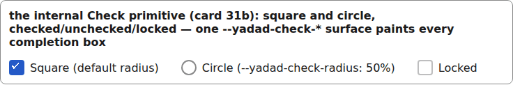
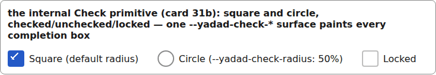

# check

The internal completion box behind every checkbox in the set (boolean fields, calendar done, board done). Not in the registry — components import it from `sets/internal/check/v1/`. One `--yadad-check-*` surface paints every completion box, so they agree.

```tsx
import { Check } from "@yadad/components/internal/check";  // internal: components use it, hosts normally do not

<label>
  <Check checked={square} onChange={(e) => setSquare(e.target.checked)} aria-label="Square check" />
  Square (default radius)
</label>
<label style={{ "--yadad-check-radius": "50%" } as CSSProperties}>
  <Check checked={circle} onChange={(e) => setCircle(e.target.checked)} aria-label="Circle check" />
  Circle (--yadad-check-radius: 50%)
</label>
<label>
  <Check checked={false} disabled onChange={() => {}} aria-label="Locked check" />
  Locked
</label>
```



*the Check primitive: square and circle boxes, checked and unchecked, and a locked one (1280px, light).*


## Theming

- `--yadad-check-size` — side of the drawn box (the label around it stays the 44px tap target); default: `calc(var(--yadad-space-4) + var(--yadad-space-1) + var(--yadad-focus-ring-width))` (token-derived: `--yadad-focus-ring-width`, `--yadad-space-1`, `--yadad-space-4`)
- `--yadad-check-radius` — corner radius of the box (`50%` gives the SPA's circle); default: token `--yadad-radius-sm` (small corner radius (inputs, buttons, chips))
- `--yadad-check-border-width` — box border width; default: token `--yadad-focus-ring-width` (keyboard focus-ring width)
- `--yadad-check-border` — box border colour at rest; default: token `--yadad-color-border` (borders and dividers)
- `--yadad-check-border-hover` — box border colour under the pointer; default: token `--yadad-color-accent` (brand / primary accent — links, focus ring, selected state)
- `--yadad-check-off` — box fill when unchecked; default: token `--yadad-color-background` (page and control background)
- `--yadad-check-on` — box fill and border when checked (the accent fill of the SPA look); default: token `--yadad-color-accent` (brand / primary accent — links, focus ring, selected state)
- `--yadad-check-focus` — focus-ring colour of the box; default: token `--yadad-color-accent` (brand / primary accent — links, focus ring, selected state)
- `--yadad-check-tick-color` — colour of the tick stroke (over the checked fill); default: token `--yadad-color-background` (page and control background)
- `--yadad-check-tick-width` — thickness of the tick stroke; default: token `--yadad-focus-ring-width` (keyboard focus-ring width)

Before (the picture above) and after one host override:

```css
[data-yadad-check] { --yadad-check-size: 28px; }
```



*the Check primitive after a host override enlarging --yadad-check-size to 28px (1280px, light).*
