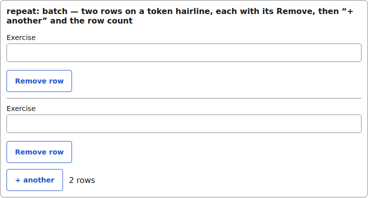
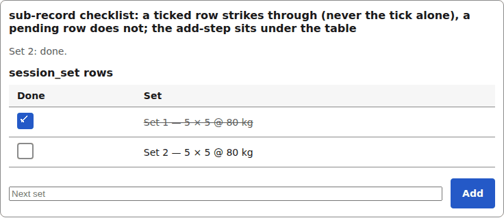

# composer

The chrome the renderer draws around saved filters, batch repeat rows and sub-record checklists (RFC 0009). The set styles the markup; the renderer owns the attributes.

## Saved-filter chips

```tsx
<ChipRow label="Saved filters">
  <Chip label="This month" pressed={false} onPress={() => {}} />
  <Chip label="Heavy only" pressed onPress={() => {}} />
  {/* ...two more... */}
</ChipRow>
```


*the saved-filter chip row with one chip pressed (filled, aria-pressed) (1280px, light).*

## Batch repeat rows

```tsx
<div data-yadad-batch-row="">
  {/* a repeat row: the fields the repeat defines on the view */}
  <TextInput inputId="g-batch-0" field={exerciseField} value="Squat" onChange={() => {}} invalid={false} />
  <Button label="Remove row" type="button" variant="secondary" disabled={false} onPress={() => {}} />
</div>
<div data-yadad-batch-controls="">
  <Button label="+ another" type="button" variant="secondary" disabled={false} onPress={() => {}} />
  <span data-yadad-batch-count="" role="status">2 rows</span>
</div>
```



*the batch composer: two repeat rows on a hairline, the + another controls and the row count (1280px, light).*

## Sub-record checklist

```tsx
<div data-yadad-sub-records="session_set">
  <Table caption="session_set rows" columns={checklistColumns}
    rows={[checklistRow(1, true), checklistRow(2, false)]} onSort={() => {}} />
  <div data-yadad-sub-record-add="">
    <input type="text" placeholder="Next set" aria-label="Next set" />
    <Button label="Add" type="submit" variant="primary" disabled={false} onPress={() => {}} />
  </div>
</div>
```



*the sub-record checklist: a ticked row strikes through, a pending row does not, the add step sits under the table (1280px, light).*


## Theming

- `--yadad-composer-chip-gap` — gap between saved-filter chips in the chip row; default: token `--yadad-space-2` (spacing scale, step 2)
- `--yadad-composer-chip-radius` — corner radius of a saved-filter chip (pill by default); default: `calc((var(--yadad-space-4) * 2 + var(--yadad-space-3)) / 2)` (token-derived: `--yadad-space-3`, `--yadad-space-4`)
- `--yadad-composer-chip-padding-inline` — chip's inline padding (snugger than a full button); default: token `--yadad-space-4` (spacing scale, step 4 (loosest))
- `--yadad-composer-row-border-width` — hairline width between batch repeat rows; default: `1px`
- `--yadad-composer-row-border` — hairline colour between batch repeat rows; default: token `--yadad-color-border` (borders and dividers)
- `--yadad-composer-row-gap` — vertical rhythm between batch rows, controls and the checklist add-step; default: token `--yadad-space-3` (spacing scale, step 3)
- `--yadad-composer-controls-gap` — gap inside the batch controls and the checklist add-step; default: token `--yadad-space-3` (spacing scale, step 3)
- `--yadad-composer-status-color` — colour of the checklist/batch status line (role=status); default: token `--yadad-color-text-muted` (secondary / muted text (labels, captions, empty states))
- `--yadad-composer-completed-color` — text colour of a completed (ticked) checklist row, struck through; default: token `--yadad-color-text-muted` (secondary / muted text (labels, captions, empty states))

Before (the picture above) and after one host override:

```css
[data-yadad=chip-row] { --yadad-composer-chip-radius: 999px; }
```


*the chip row after a host override raising --yadad-composer-chip-radius to a pill (1280px, light).*
