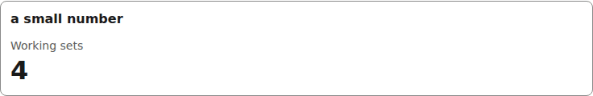
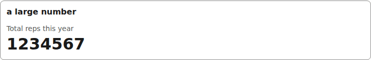
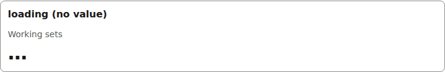
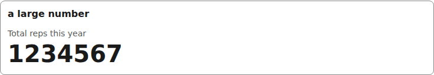

# count

A label over a large number; with no value it shows the loading skeleton.

```tsx
<Count label="Working sets" value={4} />
```



*the count widget with a small number (1280px, light).*

```tsx
<Count label="Total reps this year" value={1234567} />
```



*the count widget with a large number (1280px, light).*

```tsx
<Count label="Working sets" value={undefined} />
```



*the count widget while loading: a skeleton block where the number will be (1280px, light).*


## Theming

- `--yadad-count-gap` — gap between label and value; default: token `--yadad-space-1` (spacing scale, step 1 (tightest))
- `--yadad-count-font-family` — font stack; default: token `--yadad-font-family` (base font stack)
- `--yadad-count-label-size` — label font size; default: token `--yadad-font-size-sm` (small text (labels, secondary, table cells))
- `--yadad-count-label-color` — label color; default: token `--yadad-color-text-muted` (secondary / muted text (labels, captions, empty states))
- `--yadad-count-value-size` — value font size; default: `calc(var(--yadad-font-size-md) * 2)` (token-derived: `--yadad-font-size-md`)
- `--yadad-count-value-color` — value color; default: token `--yadad-color-text` (main text color)

Before (the picture above) and after one host override:

```css
[data-yadad=count] { --yadad-count-value-size: 2.5rem; }
```



*the count widget after a host override enlarging --yadad-count-value-size (1280px, light).*
