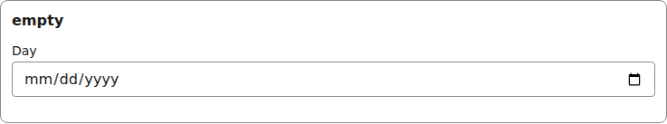
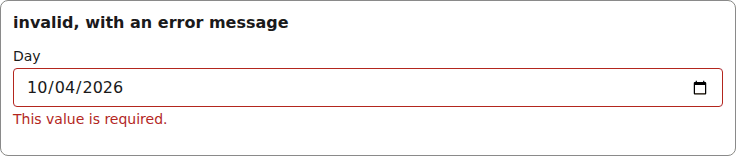
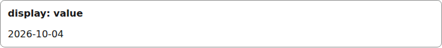
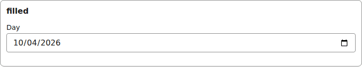

# date

A native date input (`YYYY-MM-DD` in and out), bounded by the field's `min` / `max`.

Registry entry `fields.date` in `registry/base.ts` pairs an `Input` with a read-only `Display`.

## Input

The renderer wraps each Input in [FieldFrame](./field-frame.md) (label, required marker, errors):

```tsx
<DateInput
  inputId="g-x"
  field={{ id: "day", type: "date", label: "Day", min: "2026-01-01", max: "2026-12-31" }}
  value={"2026-10-04"}
  onChange={() => {}}
  invalid={false}
/>
```


*the date input with a value (1280px, light).*

```tsx
<DateInput
  inputId="g-x"
  field={{ id: "day", type: "date", label: "Day", min: "2026-01-01", max: "2026-12-31" }}
  value={undefined}
  onChange={() => {}}
  invalid={false}
/>
```



*the date input with no value (1280px, light).*

```tsx
<DateInput
  inputId="g-x"
  field={{ id: "day", type: "date", label: "Day", min: "2026-01-01", max: "2026-12-31" }}
  value={"2026-10-04"}
  onChange={() => {}}
  invalid={true}
  describedBy="g-x-errors"  // only when invalid
/>
// and FieldFrame errors={[requiredError("/day")  // "Day is outside the allowed range."]}
```



*the date input with a validation error (1280px, light).*

## Display

```tsx
<DateDisplay field={{ id: "day", type: "date", label: "Day", min: "2026-01-01", max: "2026-12-31" }}
  value={"2026-10-04"}
/>
```



*the date Display with a value (1280px, light).*


## Theming

- `--yadad-date-width` — inline size; default: `100%`
- `--yadad-date-padding` — inner padding; default: `var(--yadad-space-2) var(--yadad-space-3)` (token-derived: `--yadad-space-2`, `--yadad-space-3`)
- `--yadad-date-font-family` — font stack; default: token `--yadad-font-family` (base font stack)
- `--yadad-date-font-size` — font size; default: token `--yadad-font-size-md` (base text (inputs, body, tab labels))
- `--yadad-date-color` — foreground color; default: token `--yadad-color-text` (main text color)
- `--yadad-date-background` — background; default: token `--yadad-color-background` (page and control background)
- `--yadad-date-border-width` — border width; default: `1px`
- `--yadad-date-border` — border color; default: token `--yadad-color-border` (borders and dividers)
- `--yadad-date-radius` — corner radius; default: token `--yadad-radius-sm` (small corner radius (inputs, buttons, chips))
- `--yadad-date-focus` — focus-ring color; default: token `--yadad-color-accent` (brand / primary accent — links, focus ring, selected state)
- `--yadad-date-border-invalid` — border color when invalid; default: token `--yadad-color-danger` (error / danger text and borders)
- `--yadad-date-touch-font-size` — input font size under a coarse pointer; defaults to the larger of 1rem and the theme's font-size-md, so it never drops below 16px. Set it smaller only on purpose: iOS then zooms on focus; default: `var(--yadad-touch-font-size, max(var(--yadad-space-4), var(--yadad-font-size-md)))` (token-derived: `--yadad-font-size-md`, `--yadad-space-4`)
- `--yadad-date-tap` — minimum input height under a coarse pointer (the tap target on a phone); default: `var(--yadad-touch-tap, calc(var(--yadad-space-4) * 2 + var(--yadad-space-3)))` (token-derived: `--yadad-space-3`, `--yadad-space-4`)

Before (the picture above) and after one host override. Host CSS is unlayered, so it wins over the component layer without `!important`:

```css
[data-yadad="date"] input { --yadad-date-radius: 999px; }
```



*the date input after a host override of its radius variables (1280px, light).*
