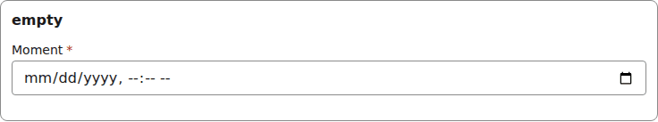
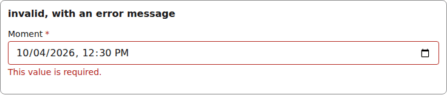
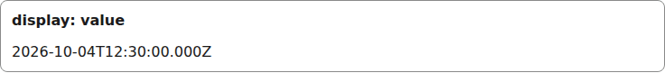
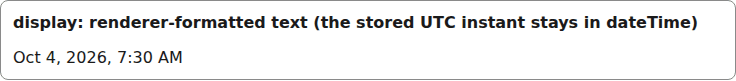
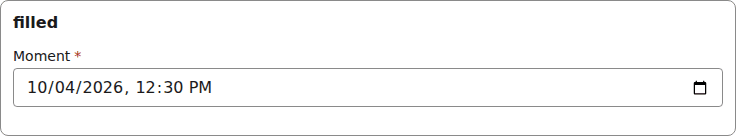

# datetime

A native `datetime-local` input. The renderer passes the local value; the document keeps the UTC instant. The Display is a `<time>` element.

Registry entry `fields.datetime` in `registry/base.ts` pairs an `Input` with a read-only `Display`.

## Input

The renderer wraps each Input in [FieldFrame](./field-frame.md) (label, required marker, errors):

```tsx
<DatetimeInput
  inputId="g-x"
  field={{ id: "moment", type: "datetime", label: "Moment", required: true }}
  value={"2026-10-04T12:30"  // the local form derived from "2026-10-04T12:30:00.000Z"}
  onChange={() => {}}
  invalid={false}
/>
```


*the datetime input with a value (1280px, light).*

```tsx
<DatetimeInput
  inputId="g-x"
  field={{ id: "moment", type: "datetime", label: "Moment", required: true }}
  value={undefined}
  onChange={() => {}}
  invalid={false}
/>
```



*the datetime input with no value (1280px, light).*

```tsx
<DatetimeInput
  inputId="g-x"
  field={{ id: "moment", type: "datetime", label: "Moment", required: true }}
  value={"2026-10-04T12:30"  // the local form derived from "2026-10-04T12:30:00.000Z"}
  onChange={() => {}}
  invalid={true}
  describedBy="g-x-errors"  // only when invalid
/>
// and FieldFrame errors={[requiredError("/moment")]}
```



*the datetime input with a validation error (1280px, light).*

## Display

```tsx
<DatetimeDisplay field={{ id: "moment", type: "datetime", label: "Moment", required: true }}
  value="2026-10-04T12:30:00.000Z"
/>
```



*the datetime Display with a value (1280px, light).*

The `text` prop carries the renderer-formatted string; the value stays the stored UTC instant:

```tsx
<DatetimeDisplay field={{ id: "moment", type: "datetime", label: "Moment", required: true }}
  value="2026-10-04T12:30:00.000Z"
  text="Oct 4, 2026, 7:30 AM"
/>
```



*the datetime Display: the stored instant, renderer-formatted (1280px, light).*


## Theming

- `--yadad-datetime-width` — inline size; default: `100%`
- `--yadad-datetime-padding` — inner padding; default: `var(--yadad-space-2) var(--yadad-space-3)` (token-derived: `--yadad-space-2`, `--yadad-space-3`)
- `--yadad-datetime-font-family` — font stack; default: token `--yadad-font-family` (base font stack)
- `--yadad-datetime-font-size` — font size; default: token `--yadad-font-size-md` (base text (inputs, body, tab labels))
- `--yadad-datetime-color` — foreground color; default: token `--yadad-color-text` (main text color)
- `--yadad-datetime-background` — background; default: token `--yadad-color-background` (page and control background)
- `--yadad-datetime-border-width` — border width; default: `1px`
- `--yadad-datetime-border` — border color; default: token `--yadad-color-border` (borders and dividers)
- `--yadad-datetime-radius` — corner radius; default: token `--yadad-radius-sm` (small corner radius (inputs, buttons, chips))
- `--yadad-datetime-focus` — focus-ring color; default: token `--yadad-color-accent` (brand / primary accent — links, focus ring, selected state)
- `--yadad-datetime-border-invalid` — border color when invalid; default: token `--yadad-color-danger` (error / danger text and borders)
- `--yadad-datetime-touch-font-size` — input font size under a coarse pointer; defaults to the larger of 1rem and the theme's font-size-md, so it never drops below 16px. Set it smaller only on purpose: iOS then zooms on focus; default: `var(--yadad-touch-font-size, max(var(--yadad-space-4), var(--yadad-font-size-md)))` (token-derived: `--yadad-font-size-md`, `--yadad-space-4`)
- `--yadad-datetime-tap` — minimum input height under a coarse pointer (the tap target on a phone); default: `var(--yadad-touch-tap, calc(var(--yadad-space-4) * 2 + var(--yadad-space-3)))` (token-derived: `--yadad-space-3`, `--yadad-space-4`)

Before (the picture above) and after one host override. Host CSS is unlayered, so it wins over the component layer without `!important`:

```css
[data-yadad="datetime"] input { --yadad-datetime-radius: 999px; }
```



*the datetime input after a host override of its radius variables (1280px, light).*
