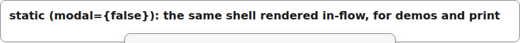
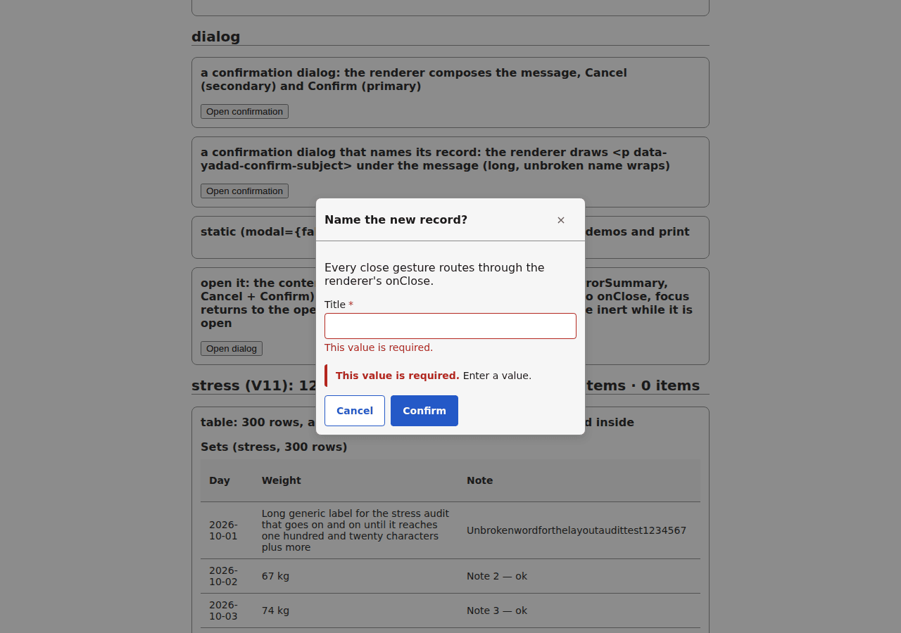
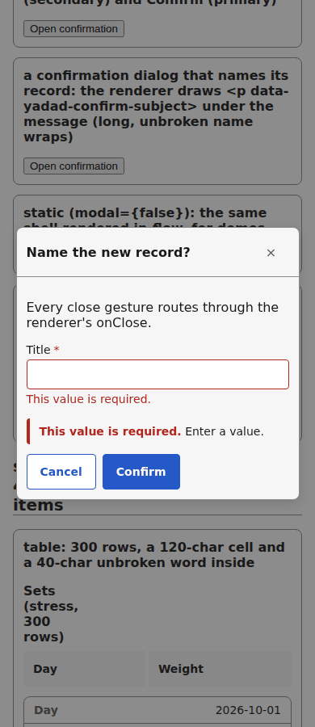
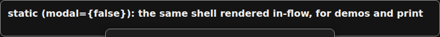
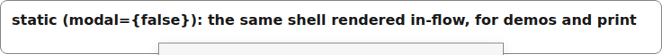

# dialog

A native `<dialog>`: `showModal()` when the browser supports it, an `open`-attribute fallback otherwise. Focus is trapped, the background is inert, Escape and a background press route to `onClose`, and focus returns to the opener. The renderer composes the content.

## Static

With `modal={false}` the same shell renders in flow (demos, print):

```tsx
<Dialog label="Delete record?" onClose={() => {}} modal={false}>
  <p>Deleting is permanent.</p>
  <p className="dialog-buttons">
    <Button label="Cancel" type="button" variant="secondary" disabled={false} />
    <Button label="Delete" type="button" variant="primary" tone="danger" disabled={false} />
  </p>
</Dialog>
```



*the dialog rendered static: header with close button, body, Cancel and Delete (1280px, light).*

## Modal

```tsx
const [open, setOpen] = useState(false);
<button type="button" onClick={() => setOpen(true)}>Open dialog</button>
{open ? (
  <Dialog label="Name the new record?" onClose={() => setOpen(false)}>
    <p>Every close gesture routes through the renderer's onClose.</p>
    <FieldFrame inputId="dialog-demo-name" errorId="dialog-demo-name-errors" label="Title" required errors={errors}>
      <TextInput inputId="dialog-demo-name" field={field} value={name || undefined}
        onChange={(v) => setName(v ?? "")} invalid={name === ""} />
    </FieldFrame>
    {name === "" ? <ErrorSummary id="dialog-errors" errors={[requiredError("/title")]} /> : null}
    <Button label="Cancel" type="button" variant="secondary" onPress={() => setOpen(false)} />
    <Button label="Confirm" type="button" variant="primary" onPress={() => setOpen(false)} />
  </Dialog>
) : null}
```



*the modal dialog open over the page: scrim, invalid field with its error summary, Cancel and Confirm side by side (1280px, light).*

## Modal on a phone



*the modal dialog at phone width (390px, phone).*

## Dark



*the static dialog in the dark theme (1280px, light).*


## Theming

- `--yadad-dialog-width` — inline size; default: `min(90%, calc(var(--yadad-space-4) * 24))` (token-derived: `--yadad-space-4`)
- `--yadad-dialog-max-width` — maximum inline size on wide screens; default: `calc(var(--yadad-space-4) * 40)` (token-derived: `--yadad-space-4`)
- `--yadad-dialog-max-height` — maximum height before the body scrolls; default: `85%`
- `--yadad-dialog-border-width` — border width; default: `1px`
- `--yadad-dialog-border` — border color; default: token `--yadad-color-border` (borders and dividers)
- `--yadad-dialog-radius` — corner radius; default: token `--yadad-radius-md` (medium corner radius (cards, panels, sections))
- `--yadad-dialog-background` — background; default: token `--yadad-color-surface` (raised surface (sections, panels, table headers))
- `--yadad-dialog-color` — foreground color; default: token `--yadad-color-text` (main text color)
- `--yadad-dialog-font-family` — font stack; default: token `--yadad-font-family` (base font stack)
- `--yadad-dialog-font-size` — font size; default: token `--yadad-font-size-md` (base text (inputs, body, tab labels))
- `--yadad-dialog-shadow` — drop shadow under the dialog box; default: `var(--yadad-shadow-md, none)` (token-derived: `--yadad-shadow-md`)
- `--yadad-dialog-backdrop` — backdrop colour (top layer only); default: token `--yadad-color-text` (main text color)
- `--yadad-dialog-backdrop-opacity` — backdrop opacity (top layer only); default: `0.5`
- `--yadad-dialog-focus` — focus-ring color; default: token `--yadad-color-accent` (brand / primary accent — links, focus ring, selected state)
- `--yadad-dialog-header-gap` — gap between the title and the close control; default: token `--yadad-space-2` (spacing scale, step 2)
- `--yadad-dialog-header-padding` — header padding; default: `var(--yadad-space-2) var(--yadad-space-3)` (token-derived: `--yadad-space-2`, `--yadad-space-3`)
- `--yadad-dialog-header-border-width` — header separator width; default: `1px`
- `--yadad-dialog-header-border` — header separator color; default: token `--yadad-color-border` (borders and dividers)
- `--yadad-dialog-title-font-size` — title font size; default: token `--yadad-font-size-md` (base text (inputs, body, tab labels))
- `--yadad-dialog-close-tap` — close control tap target (width and height); default: `var(--yadad-touch-tap, calc(var(--yadad-space-4) * 2 + var(--yadad-space-3)))` (token-derived: `--yadad-space-3`, `--yadad-space-4`)
- `--yadad-dialog-close-color` — close control colour; default: token `--yadad-color-text-muted` (secondary / muted text (labels, captions, empty states))
- `--yadad-dialog-close-font-size` — close control glyph size; default: token `--yadad-font-size-md` (base text (inputs, body, tab labels))
- `--yadad-dialog-close-radius` — close control corner radius; default: token `--yadad-radius-sm` (small corner radius (inputs, buttons, chips))
- `--yadad-dialog-close-focus` — close control focus-ring colour; default: token `--yadad-color-accent` (brand / primary accent — links, focus ring, selected state)
- `--yadad-dialog-body-padding` — body padding; default: token `--yadad-space-3` (spacing scale, step 3)
- `--yadad-dialog-subject-margin` — margin around the confirm subject line; default: `var(--yadad-space-2) 0` (token-derived: `--yadad-space-2`)
- `--yadad-dialog-subject-color` — confirm subject line text color; default: token `--yadad-color-text` (main text color)
- `--yadad-dialog-subject-font-size` — confirm subject line font size; default: token `--yadad-font-size-md` (base text (inputs, body, tab labels))
- `--yadad-dialog-subject-font-weight` — confirm subject line font weight; default: `600`

Before (the pictures above) and after one host override:

```css
[data-yadad=dialog] { --yadad-dialog-radius: 0px; }
```



*the static dialog after a host override squaring off --yadad-dialog-radius (1280px, light).*
