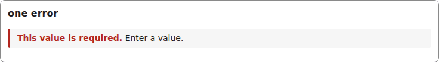
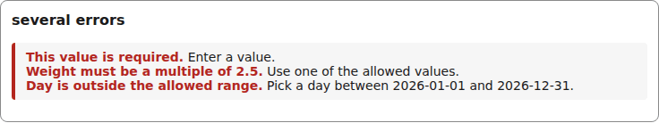
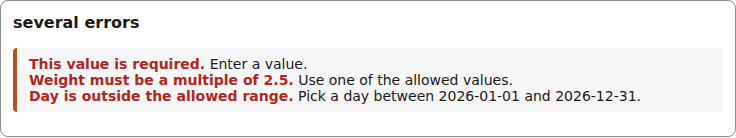

# error-summary

A `role=alert` list of the document's errors, each with its hint, for the top of a form or a dialog.

```tsx
<ErrorSummary id="g-errors"
  errors={[requiredError("/name")]}
/>
```



*the error summary with one error and its hint (1280px, light).*

```tsx
<ErrorSummary id="g-errors"
  errors={[
    requiredError("/name"),
    invalidError("/weight", "Weight must be a multiple of 2.5."),
    { path: "/day", code: "invalid-value", message: "Day is outside the allowed range.",
      hint: "Pick a day between 2026-01-01 and 2026-12-31." },
  ]}
/>
```



*the error summary with three errors, each with its hint (1280px, light).*


## Theming

- `--yadad-error-summary-spacing` — space after the summary; default: token `--yadad-space-3` (spacing scale, step 3)
- `--yadad-error-summary-padding` — inner padding; default: `var(--yadad-space-2) var(--yadad-space-3)` (token-derived: `--yadad-space-2`, `--yadad-space-3`)
- `--yadad-error-summary-bar-width` — leading bar width; default: token `--yadad-space-1` (spacing scale, step 1 (tightest))
- `--yadad-error-summary-bar` — leading bar color; default: token `--yadad-color-danger` (error / danger text and borders)
- `--yadad-error-summary-radius` — corner radius; default: token `--yadad-radius-sm` (small corner radius (inputs, buttons, chips))
- `--yadad-error-summary-background` — background; default: token `--yadad-color-surface` (raised surface (sections, panels, table headers))
- `--yadad-error-summary-font-family` — font stack; default: token `--yadad-font-family` (base font stack)
- `--yadad-error-summary-font-size` — font size; default: token `--yadad-font-size-sm` (small text (labels, secondary, table cells))
- `--yadad-error-summary-color` — message color; default: token `--yadad-color-danger` (error / danger text and borders)
- `--yadad-error-summary-hint-color` — hint color; default: token `--yadad-color-text` (main text color)

Before (the picture above) and after one host override:

```css
[data-yadad=error-summary] { --yadad-error-summary-bar: #b3541e; }
```



*the error summary after a host override recolouring --yadad-error-summary-bar (1280px, light).*
