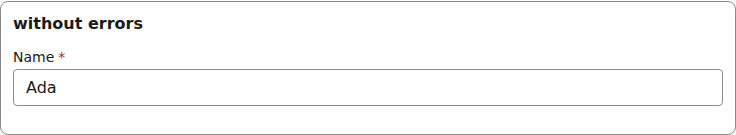
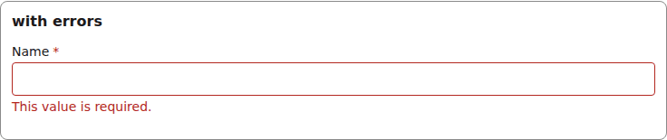
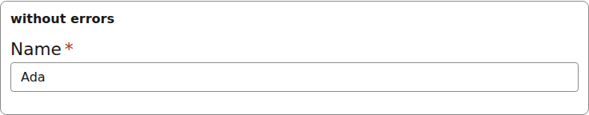

# field-frame

The label, required marker and error list every field input renders inside. The renderer owns it; a host rendering an input directly wraps it the same way.

## Clean

```tsx
<FieldFrame inputId="g-frame" errorId="g-frame-errors" label="Name" required errors={[]}>
  <TextInput inputId="g-frame" field={field} value="Ada" onChange={() => {}} invalid={false} />
</FieldFrame>
```



*the field frame: label with its required marker around a clean input (1280px, light).*

## With errors

```tsx
<FieldFrame inputId="g-frame" errorId="g-frame-errors" label="Name" required
  errors={[requiredError("/name")]}>
  <TextInput inputId="g-frame" field={field} value={undefined} onChange={() => {}} invalid describedBy="g-frame-errors" />
</FieldFrame>
```



*the field frame with a validation error under the input (1280px, light).*


## Theming

- `--yadad-field-frame-gap` — gap between label, control and error; default: token `--yadad-space-1` (spacing scale, step 1 (tightest))
- `--yadad-field-frame-spacing` — space after the field; default: token `--yadad-space-4` (spacing scale, step 4 (loosest))
- `--yadad-field-frame-font-family` — font stack; default: token `--yadad-font-family` (base font stack)
- `--yadad-field-frame-label-size` — label font size; default: token `--yadad-font-size-sm` (small text (labels, secondary, table cells))
- `--yadad-field-frame-label-color` — label color; default: token `--yadad-color-text` (main text color)
- `--yadad-field-frame-checkbox-tap` — minimum tap-target height of the checkbox label (phone); default: `var(--yadad-touch-tap, calc(var(--yadad-space-4) * 2 + var(--yadad-space-3)))` (token-derived: `--yadad-space-3`, `--yadad-space-4`)
- `--yadad-field-frame-required-color` — required-marker color; default: token `--yadad-color-danger` (error / danger text and borders)
- `--yadad-field-frame-error-size` — error font size; default: token `--yadad-font-size-sm` (small text (labels, secondary, table cells))
- `--yadad-field-frame-error-color` — error color; default: token `--yadad-color-danger` (error / danger text and borders)

Before (the picture above) and after one host override:

```css
[data-yadad=field-frame] { --yadad-field-frame-label-size: 1.35rem; }
```



*the field frame after a host override enlarging --yadad-field-frame-label-size (1280px, light).*
