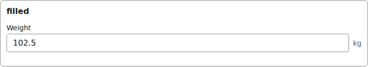
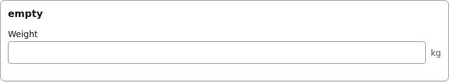
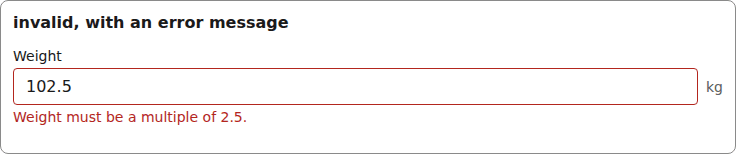
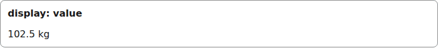
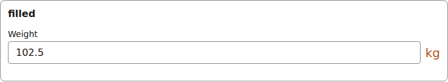

# number

A numeric input that keeps the document's number type; the field's optional `unit` paints beside it.

Registry entry `fields.number` in `registry/base.ts` pairs an `Input` with a read-only `Display`.

## Input

The renderer wraps each Input in [FieldFrame](./field-frame.md) (label, required marker, errors):

```tsx
<NumberInput
  inputId="g-x"
  field={{ id: "weight", type: "number", label: "Weight", min: 0, step: 2.5, unit: "kg" }}
  value={102.5}
  onChange={() => {}}
  invalid={false}
/>
```



*the number input with a value (1280px, light).*

```tsx
<NumberInput
  inputId="g-x"
  field={{ id: "weight", type: "number", label: "Weight", min: 0, step: 2.5, unit: "kg" }}
  value={undefined}
  onChange={() => {}}
  invalid={false}
/>
```



*the number input with no value (1280px, light).*

```tsx
<NumberInput
  inputId="g-x"
  field={{ id: "weight", type: "number", label: "Weight", min: 0, step: 2.5, unit: "kg" }}
  value={102.5}
  onChange={() => {}}
  invalid={true}
  describedBy="g-x-errors"  // only when invalid
/>
// and FieldFrame errors={[invalidError("/weight", "Weight must be a multiple of 2.5.")]}
```



*the number input with a validation error (1280px, light).*

## Display

```tsx
<NumberDisplay field={{ id: "weight", type: "number", label: "Weight", min: 0, step: 2.5, unit: "kg" }}
  value={102.5}
/>
```



*the number Display with a value (1280px, light).*


## Theming

- `--yadad-number-gap` — gap between input and unit; default: token `--yadad-space-2` (spacing scale, step 2)
- `--yadad-number-width` — inline size; default: `100%`
- `--yadad-number-padding` — inner padding; default: `var(--yadad-space-2) var(--yadad-space-3)` (token-derived: `--yadad-space-2`, `--yadad-space-3`)
- `--yadad-number-font-family` — font stack; default: token `--yadad-font-family` (base font stack)
- `--yadad-number-font-size` — font size; default: token `--yadad-font-size-md` (base text (inputs, body, tab labels))
- `--yadad-number-color` — foreground color; default: token `--yadad-color-text` (main text color)
- `--yadad-number-background` — background; default: token `--yadad-color-background` (page and control background)
- `--yadad-number-border-width` — border width; default: `1px`
- `--yadad-number-border` — border color; default: token `--yadad-color-border` (borders and dividers)
- `--yadad-number-radius` — corner radius; default: token `--yadad-radius-sm` (small corner radius (inputs, buttons, chips))
- `--yadad-number-focus` — focus-ring color; default: token `--yadad-color-accent` (brand / primary accent — links, focus ring, selected state)
- `--yadad-number-border-invalid` — border color when invalid; default: token `--yadad-color-danger` (error / danger text and borders)
- `--yadad-number-unit-size` — unit font size; default: token `--yadad-font-size-sm` (small text (labels, secondary, table cells))
- `--yadad-number-unit-color` — unit color; default: token `--yadad-color-text-muted` (secondary / muted text (labels, captions, empty states))
- `--yadad-number-touch-font-size` — input font size under a coarse pointer; defaults to the larger of 1rem and the theme's font-size-md, so it never drops below 16px. Set it smaller only on purpose: iOS then zooms on focus; default: `var(--yadad-touch-font-size, max(var(--yadad-space-4), var(--yadad-font-size-md)))` (token-derived: `--yadad-font-size-md`, `--yadad-space-4`)
- `--yadad-number-tap` — minimum input height under a coarse pointer (the tap target on a phone); default: `var(--yadad-touch-tap, calc(var(--yadad-space-4) * 2 + var(--yadad-space-3)))` (token-derived: `--yadad-space-3`, `--yadad-space-4`)

Before (the picture above) and after one host override. Host CSS is unlayered, so it wins over the component layer without `!important`:

```css
[data-yadad=number] { --yadad-number-unit-size: 1.25rem; --yadad-number-unit-color: #b3541e; }
```



*the number input after a host override of its unit variables (1280px, light).*
