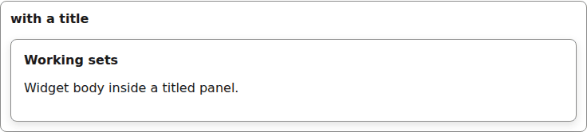
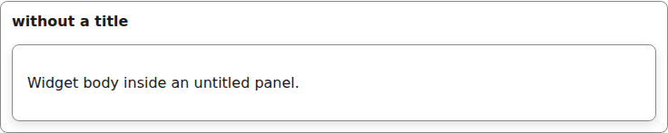
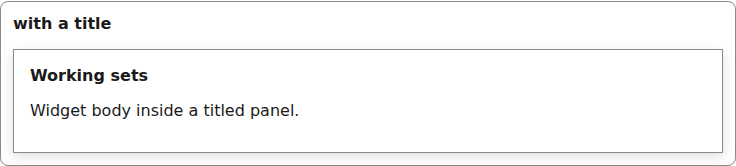

# panel

A surface card for widgets and small forms, optionally titled.

```tsx
<Panel title="Working sets">
  <p>Widget body inside a titled panel.</p>
</Panel>
```



*the panel with its title above a bordered body (1280px, light).*

```tsx
<Panel>
  <p>Widget body inside an untitled panel.</p>
</Panel>
```



*the panel without a title (1280px, light).*


## Theming

- `--yadad-panel-padding` — inner padding; default: token `--yadad-space-4` (spacing scale, step 4 (loosest))
- `--yadad-panel-border-width` — border width; default: `1px`
- `--yadad-panel-border` — border color; default: token `--yadad-color-border` (borders and dividers)
- `--yadad-panel-radius` — corner radius; default: token `--yadad-radius-md` (medium corner radius (cards, panels, sections))
- `--yadad-panel-background` — background; default: token `--yadad-color-background` (page and control background)
- `--yadad-panel-font-family` — font stack; default: token `--yadad-font-family` (base font stack)
- `--yadad-panel-title-size` — title font size; default: token `--yadad-font-size-md` (base text (inputs, body, tab labels))

Before (the picture above) and after one host override:

```css
[data-yadad=panel] { --yadad-panel-radius: 0px; }
```



*the panel after a host override squaring off --yadad-panel-radius (1280px, light).*
