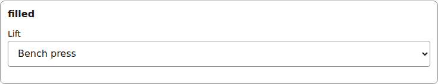
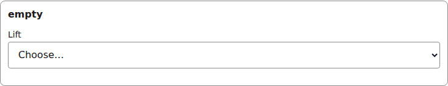
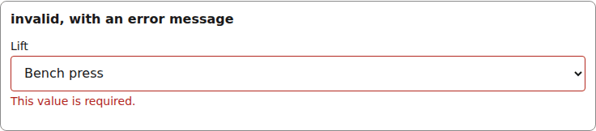
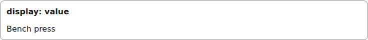
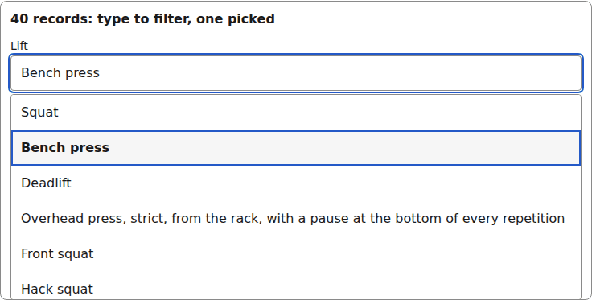
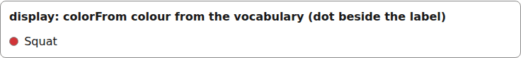
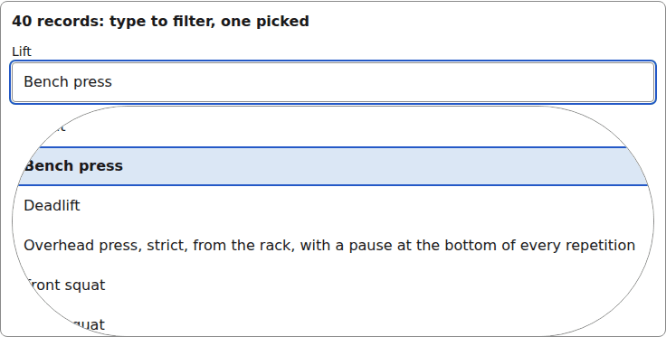

# reference

A picker over records of another entity: a `select` when the option list is short, a type-to-filter combobox when it is long. The renderer loads the options and resolves the label.

Registry entry `fields.reference` in `registry/base.ts` pairs an `Input` with a read-only `Display`.

## Input

The renderer wraps each Input in [FieldFrame](./field-frame.md) (label, required marker, errors):

```tsx
<ReferenceInput
  inputId="g-lift"
  field={{ id: "lift", type: "reference", label: "Lift", entity: "exercise" }}
  value={"e2"}
  onChange={() => {}}
  invalid={false}
  options={
    status: "ready",
    options: [
      { id: "e1", label: "Squat" },
      { id: "e2", label: "Bench press" },
      { id: "e3", label: "Deadlift" },
      { id: "e4", label: "Overhead press, strict, from the rack, with a pause at the bottom of every repetition" },
    ],
    more: false,
  }
/>
```



*the reference input with a value (1280px, light).*

```tsx
<ReferenceInput
  inputId="g-lift"
  field={{ id: "lift", type: "reference", label: "Lift", entity: "exercise" }}
  value={undefined}
  onChange={() => {}}
  invalid={false}
  options={
    status: "ready",
    options: [
      { id: "e1", label: "Squat" },
      { id: "e2", label: "Bench press" },
      { id: "e3", label: "Deadlift" },
      { id: "e4", label: "Overhead press, strict, from the rack, with a pause at the bottom of every repetition" },
    ],
    more: false,
  }
/>
```



*the reference input with no value (1280px, light).*

```tsx
<ReferenceInput
  inputId="g-lift"
  field={{ id: "lift", type: "reference", label: "Lift", entity: "exercise" }}
  value={"e2"}
  onChange={() => {}}
  invalid={true}
  describedBy="g-lift-errors"  // only when invalid
  options={
    status: "ready",
    options: [
      { id: "e1", label: "Squat" },
      { id: "e2", label: "Bench press" },
      { id: "e3", label: "Deadlift" },
      { id: "e4", label: "Overhead press, strict, from the rack, with a pause at the bottom of every repetition" },
    ],
    more: false,
  }
/>
// and FieldFrame errors={[requiredError("/lift")]}
```



*the reference input with a validation error (1280px, light).*

## Display

```tsx
<ReferenceDisplay
  field={{ id: "lift", type: "reference", label: "Lift", entity: "exercise" }}
  value={"e2"}
  label="Bench press"
  status="found"
/>
```



*the reference Display with a value (1280px, light).*

```tsx
<ReferenceInput inputId="g-combo"
  field={{ id: "lift", type: "reference", label: "Lift", entity: "exercise" }}
  value="e2"
  onChange={() => {}}
  invalid={false}
  options={ status: "ready", options: manyReferenceOptions /* 40 records */, more: false }
/>
```



*the reference combobox open over its options, one record picked (40-record list) (1280px, light).*

```tsx
<ReferenceDisplay field={{ id: "lift", type: "reference", label: "Lift", entity: "exercise" }}
  value="e1"
  label="Squat"
  status="found"
  color="#d13438"
/>
```



*the reference Display: the label with its colour-hint dot (1280px, light).*


## Theming

- `--yadad-reference-status-gap` — space between the picker and the status line; default: token `--yadad-space-1` (spacing scale, step 1 (tightest))
- `--yadad-reference-font-family` — status line font family; default: token `--yadad-font-family` (base font stack)
- `--yadad-reference-status-font-size` — status line font size; default: token `--yadad-font-size-sm` (small text (labels, secondary, table cells))
- `--yadad-reference-status-color` — status line color; default: token `--yadad-color-text-muted` (secondary / muted text (labels, captions, empty states))
- `--yadad-reference-status-color-error` — status line color when options failed to load; default: token `--yadad-color-danger` (error / danger text and borders)
- `--yadad-reference-missing-color` — label color when the record is missing or could not be looked up; default: token `--yadad-color-text-muted` (secondary / muted text (labels, captions, empty states))
- `--yadad-reference-listbox-z` — stacking order of the combobox popup; default: `1`
- `--yadad-reference-listbox-gap` — space between the input and the popup; default: token `--yadad-space-1` (spacing scale, step 1 (tightest))
- `--yadad-reference-listbox-max-height` — tallest the popup grows before it scrolls; default: `calc(var(--yadad-space-4) * 16)` (token-derived: `--yadad-space-4`)
- `--yadad-reference-option-font-size` — option font size; default: token `--yadad-font-size-md` (base text (inputs, body, tab labels))
- `--yadad-reference-option-color` — option text color; default: token `--yadad-color-text` (main text color)
- `--yadad-reference-listbox-background` — popup background; default: token `--yadad-color-background` (page and control background)
- `--yadad-reference-listbox-border-width` — popup border width; default: `1px`
- `--yadad-reference-listbox-border` — popup border color; default: token `--yadad-color-border` (borders and dividers)
- `--yadad-reference-listbox-radius` — popup corner radius; default: token `--yadad-radius-sm` (small corner radius (inputs, buttons, chips))
- `--yadad-reference-option-tap` — minimum option height, the tap target on a phone; default: `var(--yadad-touch-tap, calc(var(--yadad-space-4) * 2 + var(--yadad-space-3)))` (token-derived: `--yadad-space-3`, `--yadad-space-4`)
- `--yadad-reference-option-padding` — option padding; default: `var(--yadad-space-2) var(--yadad-space-3)` (token-derived: `--yadad-space-2`, `--yadad-space-3`)
- `--yadad-reference-option-background-active` — background of the keyboard-highlighted option; default: token `--yadad-color-surface` (raised surface (sections, panels, table headers))
- `--yadad-reference-option-outline-active` — outline color of the keyboard-highlighted option; default: token `--yadad-color-accent` (brand / primary accent — links, focus ring, selected state)
- `--yadad-reference-option-weight-selected` — font weight of the currently selected option; default: `600`

Before (the picture above) and after one host override. Host CSS is unlayered, so it wins over the component layer without `!important`:

```css
[data-yadad=reference] { --yadad-reference-option-background-active: #dbe7f5; --yadad-reference-listbox-radius: 999px; }
```



*the reference input after a host override of its option variables (1280px, light).*
