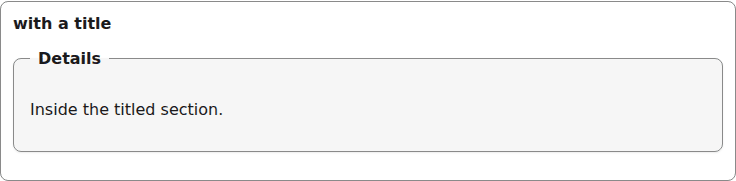
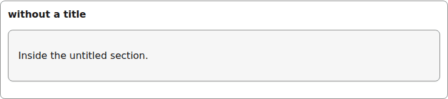
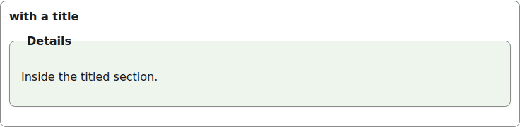

# section

A `fieldset` grouping, with an optional `legend` title.

```tsx
<Section id="g-section" title="Details">
  <p>Inside the titled section.</p>
</Section>
```



*the section with its legend title over a bordered group (1280px, light).*

```tsx
<Section id="g-section-plain">
  <p>Inside the untitled section.</p>
</Section>
```



*the section without a title (1280px, light).*


## Theming

- `--yadad-section-spacing` — space after the section; default: token `--yadad-space-4` (spacing scale, step 4 (loosest))
- `--yadad-section-padding` — inner padding; default: token `--yadad-space-4` (spacing scale, step 4 (loosest))
- `--yadad-section-border-width` — border width; default: `1px`
- `--yadad-section-border` — border color; default: token `--yadad-color-border` (borders and dividers)
- `--yadad-section-radius` — corner radius; default: token `--yadad-radius-md` (medium corner radius (cards, panels, sections))
- `--yadad-section-background` — background; default: token `--yadad-color-surface` (raised surface (sections, panels, table headers))
- `--yadad-section-font-family` — font stack; default: token `--yadad-font-family` (base font stack)
- `--yadad-section-title-size` — title font size; default: token `--yadad-font-size-md` (base text (inputs, body, tab labels))
- `--yadad-section-title-weight` — title font weight; default: `600`
- `--yadad-section-title-color` — title color; default: token `--yadad-color-text` (main text color)

Before (the picture above) and after one host override:

```css
[data-yadad=section] { --yadad-section-background: #eef5ec; }
```



*the section after a host override tinting --yadad-section-background (1280px, light).*
