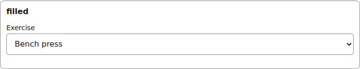
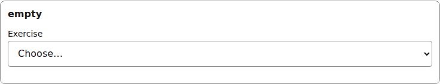
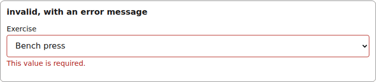
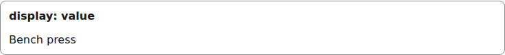
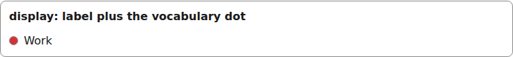

# select

A native `select` over the field's static option list; options may be objects carrying a `label` and a vocabulary `color`.

Registry entry `fields.select` in `registry/base.ts` pairs an `Input` with a read-only `Display`.

## Input

The renderer wraps each Input in [FieldFrame](./field-frame.md) (label, required marker, errors):

```tsx
<SelectInput
  inputId="g-x"
  field={{
  id: "exercise", type: "select", label: "Exercise",
  options: { source: "static", values: ["Squat", "Bench press", "Deadlift", /* ...9 more... */ "Plank"] },
}}
  value={"Bench press"}
  onChange={() => {}}
  invalid={false}
/>
```



*the select input with a value (1280px, light).*

```tsx
<SelectInput
  inputId="g-x"
  field={{
  id: "exercise", type: "select", label: "Exercise",
  options: { source: "static", values: ["Squat", "Bench press", "Deadlift", /* ...9 more... */ "Plank"] },
}}
  value={undefined}
  onChange={() => {}}
  invalid={false}
/>
```



*the select input with no value (1280px, light).*

```tsx
<SelectInput
  inputId="g-x"
  field={{
  id: "exercise", type: "select", label: "Exercise",
  options: { source: "static", values: ["Squat", "Bench press", "Deadlift", /* ...9 more... */ "Plank"] },
}}
  value={"Bench press"}
  onChange={() => {}}
  invalid={true}
  describedBy="g-x-errors"  // only when invalid
/>
// and FieldFrame errors={[requiredError("/exercise")]}
```



*the select input with a validation error (1280px, light).*

## Display

```tsx
<SelectDisplay field={{
  id: "exercise", type: "select", label: "Exercise",
  options: { source: "static", values: ["Squat", "Bench press", "Deadlift", /* ...9 more... */ "Plank"] },
}}
  value={"Bench press"}
/>
```



*the select Display with a value (1280px, light).*

```tsx
const coloured = {
  id: "list", type: "select", label: "List",
  options: {
    source: "static",
    values: [
      { value: "#464EA9", label: "Home", color: "#464EA9" },
      { value: "#D13438", label: "Work", color: "#D13438" },  // ...8 vocabulary colours
    ],
  },
} satisfies SelectField;

<SelectDisplay field={coloured} value="#D13438" />
```



*the select Display: the option label with its vocabulary colour dot (1280px, light).*


## Theming

- `--yadad-select-width` — inline size; default: `100%`
- `--yadad-select-padding` — inner padding; default: `var(--yadad-space-2) var(--yadad-space-3)` (token-derived: `--yadad-space-2`, `--yadad-space-3`)
- `--yadad-select-font-family` — font stack; default: token `--yadad-font-family` (base font stack)
- `--yadad-select-font-size` — font size; default: token `--yadad-font-size-md` (base text (inputs, body, tab labels))
- `--yadad-select-color` — foreground color; default: token `--yadad-color-text` (main text color)
- `--yadad-select-background` — background; default: token `--yadad-color-background` (page and control background)
- `--yadad-select-border-width` — border width; default: `1px`
- `--yadad-select-border` — border color; default: token `--yadad-color-border` (borders and dividers)
- `--yadad-select-radius` — corner radius; default: token `--yadad-radius-sm` (small corner radius (inputs, buttons, chips))
- `--yadad-select-tap` — minimum tap-target height (phone); default: `var(--yadad-touch-tap, calc(var(--yadad-space-4) * 2 + var(--yadad-space-3)))` (token-derived: `--yadad-space-3`, `--yadad-space-4`)
- `--yadad-select-focus` — focus-ring color; default: token `--yadad-color-accent` (brand / primary accent — links, focus ring, selected state)
- `--yadad-select-border-invalid` — border color when invalid; default: token `--yadad-color-danger` (error / danger text and borders)
- `--yadad-select-radius-full` — option-colour swatch corner radius (circular); default: `50%`
- `--yadad-select-slot-0` — colour slot 0 (categorical entry/legend color); default: no default — the host must set it
- `--yadad-select-slot-1` — colour slot 1 (categorical entry/legend color); default: no default — the host must set it
- `--yadad-select-slot-2` — colour slot 2 (categorical entry/legend color); default: no default — the host must set it
- `--yadad-select-slot-3` — colour slot 3 (categorical entry/legend color); default: no default — the host must set it
- `--yadad-select-slot-4` — colour slot 4 (categorical entry/legend color); default: no default — the host must set it
- `--yadad-select-slot-5` — colour slot 5 (categorical entry/legend color); default: no default — the host must set it
- `--yadad-select-slot-6` — colour slot 6 (categorical entry/legend color); default: no default — the host must set it
- `--yadad-select-slot-7` — colour slot 7 (categorical entry/legend color); default: no default — the host must set it
- `--yadad-select-touch-font-size` — input font size under a coarse pointer; defaults to the larger of 1rem and the theme's font-size-md, so it never drops below 16px. Set it smaller only on purpose: iOS then zooms on focus; default: `var(--yadad-touch-font-size, max(var(--yadad-space-4), var(--yadad-font-size-md)))` (token-derived: `--yadad-font-size-md`, `--yadad-space-4`)

Before (the picture above) and after one host override. Host CSS is unlayered, so it wins over the component layer without `!important`:

```css
[data-yadad="select"] select { --yadad-select-radius: 999px; }
```


*the select input after a host override of its radius variables (1280px, light).*
