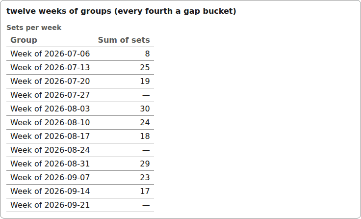
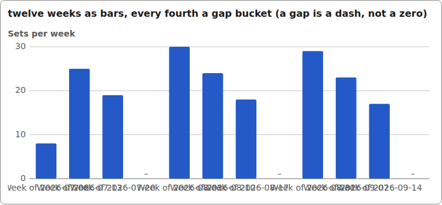
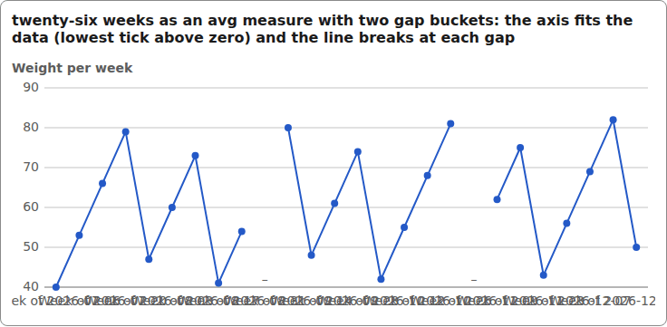
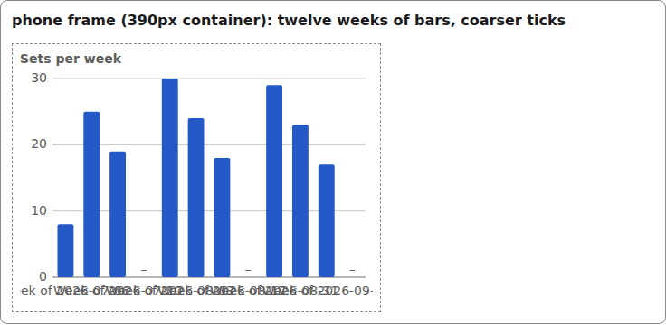
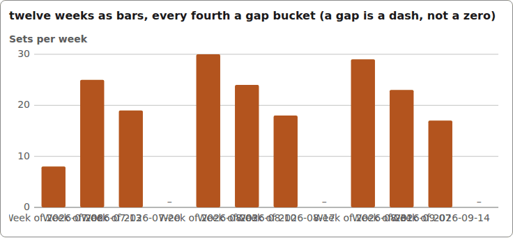

# series

One measure per group of a table view (the engine computes the groups, the component draws them): `display` `table`, `bar` or `line`. The charts are inline SVG over the same data, keyboard-operable, with the table kept as the accessible data. A gap bucket (no value) draws a dash, never a zero.

## Table

```tsx
const groups: SeriesGroupProps[] = Array.from({ length: 12 }, (_, i) => {
  const key = weekKey(i);                    // Mondays: 2026-07-06, 2026-07-13, ...
  const label = `Week of ${key}`;
  if (i % 4 === 3) return { key, label, value: undefined, text: "\u2014" };  // gap bucket
  const value = 8 + ((i * 17) % 23);
  return { key, label, value, text: String(value) };
});

<Series label="Sets per week" display="table" groups={groups}
  skipped={0} loading={false} measureLabel="Sum of sets" aggregation="sum"
/>
```



*the series widget as its accessible table: twelve weekly groups, gap rows read a dash (1280px, light).*

## Bar

```tsx
<Series label="Sets per week" display="bar" groups={groups}
  skipped={0} loading={false} measureLabel="Sum of sets" aggregation="sum"
/>
```



*the series widget as a bar chart: twelve weeks, gap buckets drawn as dashes under the axis (1280px, light).*

## Line

```tsx
const groups: SeriesGroupProps[] = Array.from({ length: 26 }, (_, i) => {
  const key = weekKey(i);                    // Mondays: 2026-07-06, 2026-07-13, ...
  const label = `Week of ${key}`;
  if (i % 4 === 3) return { key, label, value: undefined, text: "\u2014" };  // gap bucket
  const value = 8 + ((i * 17) % 23);
  return { key, label, value, text: String(value) };
});

<Series label="Weight per week" display="line" groups={groups}
  skipped={0} loading={false} measureLabel="Avg of weight" aggregation="avg"
/>
```



*the series widget as a line chart over 26 weeks: the axis fits the data and the line breaks at each gap (1280px, light).*

## In a phone frame

The bar chart inside a 390px phone container: coarser ticks, the same data.



*the series bar chart inside a phone-width frame (1280px, light).*


## Theming

- `--yadad-series-label-size` — label font size; default: token `--yadad-font-size-sm` (small text (labels, secondary, table cells))
- `--yadad-series-label-color` — label color; default: token `--yadad-color-text-muted` (secondary / muted text (labels, captions, empty states))
- `--yadad-series-gap` — gap between parts; default: token `--yadad-space-1` (spacing scale, step 1 (tightest))
- `--yadad-series-font-size` — font size; default: token `--yadad-font-size-md` (base text (inputs, body, tab labels))
- `--yadad-series-border` — border color; default: token `--yadad-color-border` (borders and dividers)
- `--yadad-series-grid` — chart gridline color; default: token `--yadad-color-border` (borders and dividers)
- `--yadad-series-note-size` — font size of the note lines; default: token `--yadad-font-size-sm` (small text (labels, secondary, table cells))
- `--yadad-series-bar` — bar fill; default: token `--yadad-color-accent` (brand / primary accent — links, focus ring, selected state)
- `--yadad-series-line` — line stroke; default: token `--yadad-color-accent` (brand / primary accent — links, focus ring, selected state)
- `--yadad-series-dot` — point dot fill; default: token `--yadad-color-accent` (brand / primary accent — links, focus ring, selected state)
- `--yadad-series-dot-active` — dot fill while hovered or focused; default: token `--yadad-color-text` (main text color)
- `--yadad-series-bar-active` — bar fill while hovered or focused; default: token `--yadad-color-text` (main text color)

Before (the picture above) and after one host override:

```css
[data-yadad=series] { --yadad-series-bar: #b3541e; }
```



*the series bar chart after a host override recolouring --yadad-series-bar (1280px, light).*
