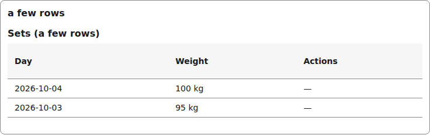
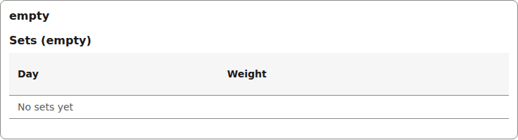
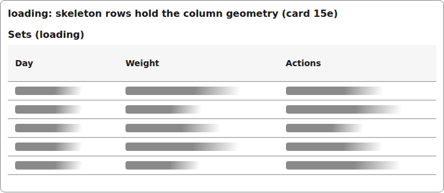
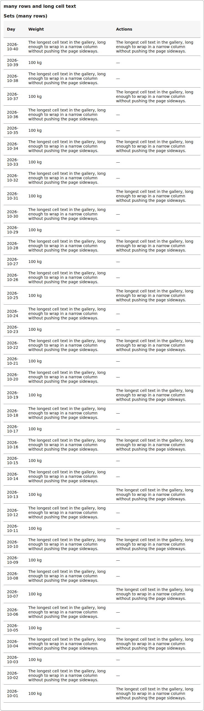
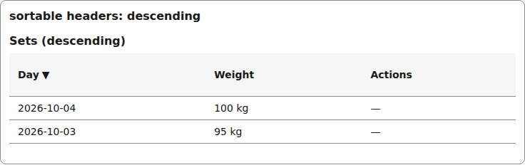
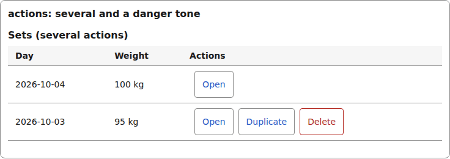
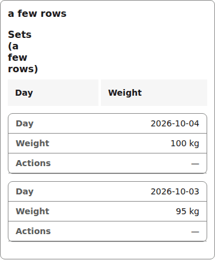
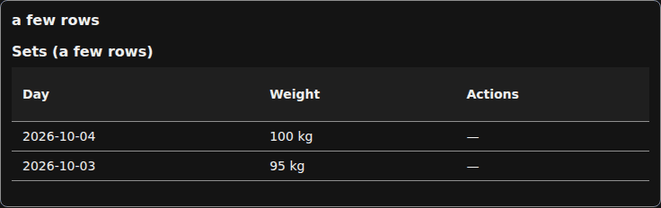
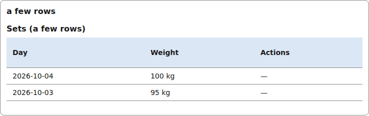

# table

A data table with sortable column headers. Under 50ch of container it switches to a stacked layout: every row becomes a card with a label on each cell.

## A few rows

```tsx
<Table caption="Sets (a few rows)" columns={[
    { id: "day", headerId: "col-day", label: "Day", sortable: true },
    { id: "weight", headerId: "col-weight", label: "Weight", sortable: false },
    { id: "note", headerId: "col-note", label: "Note", sortable: false },
  ]} rows={[
    { id: "r1", cells: ["2026-10-04", "100 kg", "\u2014"] },
    { id: "r2", cells: ["2026-10-03", "95 kg", "\u2014"] },
  ]}
  onSort={() => {}}
  empty="No sets yet"
/>
```



*the table with two rows and a sortable Day header (1280px, light).*

## Empty, loading, many rows

```tsx
<Table caption="Sets" columns={[
    { id: "day", headerId: "col-day", label: "Day", sortable: true },
    { id: "weight", headerId: "col-weight", label: "Weight", sortable: false },
    { id: "note", headerId: "col-note", label: "Note", sortable: false },
  ]} rows={[]} onSort={() => {}} empty="No sets yet" />
```



*the table with no rows: the empty message under the column headers (1280px, light).*

```tsx
<Table caption="Sets (loading)" columns={[
    { id: "day", headerId: "col-day", label: "Day", sortable: true },
    { id: "weight", headerId: "col-weight", label: "Weight", sortable: false },
    { id: "note", headerId: "col-note", label: "Note", sortable: false },
  ]} rows={[]} onSort={() => {}} empty="No sets yet" loading />
```



*the table while loading: skeleton rows hold the column geometry (1280px, light).*

```tsx
<Table caption="Sets (many rows)" columns={[
    { id: "day", headerId: "col-day", label: "Day", sortable: true },
    { id: "weight", headerId: "col-weight", label: "Weight", sortable: false },
    { id: "note", headerId: "col-note", label: "Note", sortable: false },
  ]}
  rows={Array.from({ length: 40 }, (_, i) => ({ id: `r${i}`, cells: [/* dates, long wrapped cell text */] }))}
  onSort={() => {}}
  empty="No sets yet"
/>
```



*the table with 40 rows and long cell text that wraps without pushing the page sideways (1280px, light).*

## Sorted, record actions

```tsx
const sorted = { ...columnDay, sort: "desc" };  // { id, headerId, label, sortable, sort? }
<Table caption="Sets (descending)" columns={[
    { id: "day", headerId: "col-day", label: "Day", sortable: true, sort: "desc" },
    { id: "weight", headerId: "col-weight", label: "Weight", sortable: false },
    { id: "note", headerId: "col-note", label: "Note", sortable: false },
  ]} rows={[
    { id: "r1", cells: ["2026-10-04", "100 kg", "\u2014"] },
    { id: "r2", cells: ["2026-10-03", "95 kg", "\u2014"] },
  ]}
  onSort={() => {}}
  empty="No sets"
/>
```



*the table sorted by Day descending: the header button carries the direction arrow (1280px, light).*

```tsx
rows={[
    { id: "r1", cells: ["2026-10-04", "100 kg"],
      actions: [
        { id: "a1", label: "Open", tone: "neutral", pending: false, onPress: () => {} },
        { id: "a2", label: "Delete", tone: "danger", pending: false, onPress: () => {} },
      ] },
  ]}
<Table caption="Sets (several actions)" columns={twoColumns} rows={rows} onSort={() => {}} empty="No sets" />
```



*the table with several record actions per row, one in the danger tone (1280px, light).*

## On a phone

The same table in a 390px container: the container query stacks the rows into cards.



*the table at phone width: rows stack into cards with a label on every cell (390px, phone).*

## Dark



*the table in the dark theme (1280px, light).*


## Theming

- `--yadad-table-spacing` — space after the table; default: token `--yadad-space-4` (spacing scale, step 4 (loosest))
- `--yadad-table-font-family` — font stack; default: token `--yadad-font-family` (base font stack)
- `--yadad-table-font-size` — cell font size; default: token `--yadad-font-size-sm` (small text (labels, secondary, table cells))
- `--yadad-table-color` — text color; default: token `--yadad-color-text` (main text color)
- `--yadad-table-caption-size` — caption font size; default: token `--yadad-font-size-md` (base text (inputs, body, tab labels))
- `--yadad-table-cell-padding` — cell padding; default: `var(--yadad-space-2) var(--yadad-space-3)` (token-derived: `--yadad-space-2`, `--yadad-space-3`)
- `--yadad-table-border` — row border color; default: token `--yadad-color-border` (borders and dividers)
- `--yadad-table-header-background` — header background; default: token `--yadad-color-surface` (raised surface (sections, panels, table headers))
- `--yadad-table-sort-tap` — minimum tap-target height of a sortable header (phone); default: `var(--yadad-touch-tap, calc(var(--yadad-space-4) * 2 + var(--yadad-space-3)))` (token-derived: `--yadad-space-3`, `--yadad-space-4`)
- `--yadad-table-focus` — focus-ring color; default: token `--yadad-color-accent` (brand / primary accent — links, focus ring, selected state)
- `--yadad-table-empty-color` — empty-state text color; default: token `--yadad-color-text-muted` (secondary / muted text (labels, captions, empty states))
- `--yadad-table-actions-link` — record-action button text colour; default: token `--yadad-color-accent` (brand / primary accent — links, focus ring, selected state)
- `--yadad-table-actions-border` — record-action button border colour; default: token `--yadad-color-border` (borders and dividers)
- `--yadad-table-actions-focus` — record-action button focus-ring colour; default: token `--yadad-color-accent` (brand / primary accent — links, focus ring, selected state)
- `--yadad-table-actions-danger` — danger-tone action text and border colour; default: token `--yadad-color-danger` (error / danger text and borders)
- `--yadad-table-disabled-opacity` — opacity of a disabled (pending) action button; default: `0.6`
- `--yadad-table-card-radius` — corner radius of a stacked row card (phone); default: token `--yadad-radius-md` (medium corner radius (cards, panels, sections))
- `--yadad-table-label-color` — stacked cell label color (phone); default: token `--yadad-color-text-muted` (secondary / muted text (labels, captions, empty states))
- `--yadad-table-notice-spacing` — page notice outer spacing; default: token `--yadad-space-3` (spacing scale, step 3)
- `--yadad-table-notice-padding` — page notice padding; default: `var(--yadad-space-2) var(--yadad-space-3)` (token-derived: `--yadad-space-2`, `--yadad-space-3`)
- `--yadad-table-notice-bar-width` — page notice leading bar width; default: token `--yadad-space-1` (spacing scale, step 1 (tightest))
- `--yadad-table-notice-bar` — page notice leading bar color; default: token `--yadad-color-accent` (brand / primary accent — links, focus ring, selected state)
- `--yadad-table-notice-radius` — page notice corner radius; default: token `--yadad-radius-sm` (small corner radius (inputs, buttons, chips))
- `--yadad-table-notice-background` — page notice background; default: token `--yadad-color-surface` (raised surface (sections, panels, table headers))
- `--yadad-table-notice-color` — page notice text color; default: token `--yadad-color-text` (main text color)
- `--yadad-table-notice-font-size` — page notice font size; default: token `--yadad-font-size-sm` (small text (labels, secondary, table cells))

Before (the pictures above) and after one host override:

```css
[data-yadad=table] { --yadad-table-header-background: #dbe7f5; }
```



*the table after a host override of --yadad-table-header-background (1280px, light).*
