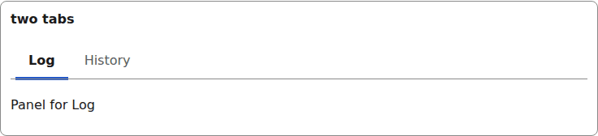
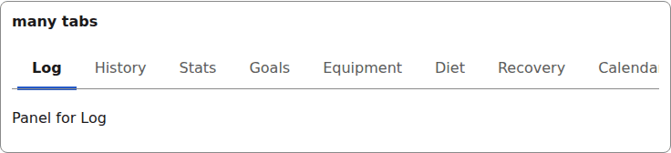
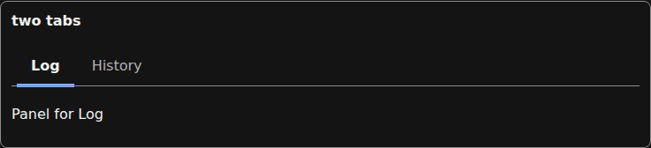
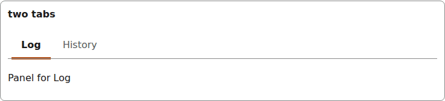

# tabs

A tablist with a roving-tabindex keyboard model; a long tab list scrolls inside its own container.

## Two tabs

```tsx
const [selected, setSelected] = useState("log");
<Tabs label="Training"
  tabs={[{ id: "log", title: "Log" }, { id: "history", title: "History" }]}
  selected={selected}
  onSelect={setSelected}
  panel={<p>Panel for {selected === "log" ? "Log" : "History"}</p>}
/>
```



*two tabs, the selected one underlined by the indicator (1280px, light).*

## Many tabs

```tsx
tabs={[{ id: "t0", title: "Log" }, { id: "t1", title: "History" }, /* ...ten titles... */ { id: "t9", title: "Settings" }]}
```



*ten tabs in a scrolling tablist (1280px, light).*

## Dark



*the two tabs in the dark theme (1280px, light).*


## Theming

- `--yadad-tabs-gap` — gap between tabs; default: token `--yadad-space-1` (spacing scale, step 1 (tightest))
- `--yadad-tabs-spacing` — space after the tab list; default: token `--yadad-space-4` (spacing scale, step 4 (loosest))
- `--yadad-tabs-font-family` — font stack; default: token `--yadad-font-family` (base font stack)
- `--yadad-tabs-ring-clearance` — clearance around the focus ring (padding + indicator offset); default: no default — the host must set it
- `--yadad-tabs-border` — border color; default: token `--yadad-color-border` (borders and dividers)
- `--yadad-tabs-padding` — tab inner padding; default: `var(--yadad-space-2) var(--yadad-space-4)` (token-derived: `--yadad-space-2`, `--yadad-space-4`)
- `--yadad-tabs-font-size` — font size; default: token `--yadad-font-size-md` (base text (inputs, body, tab labels))
- `--yadad-tabs-color` — unselected tab color; default: token `--yadad-color-text-muted` (secondary / muted text (labels, captions, empty states))
- `--yadad-tabs-indicator-width` — selected-tab indicator thickness; default: token `--yadad-space-1` (spacing scale, step 1 (tightest))
- `--yadad-tabs-tap` — minimum tap-target height (phone); default: `var(--yadad-touch-tap, calc(var(--yadad-space-4) * 2 + var(--yadad-space-3)))` (token-derived: `--yadad-space-3`, `--yadad-space-4`)
- `--yadad-tabs-selected-color` — selected tab color; default: token `--yadad-color-text` (main text color)
- `--yadad-tabs-indicator` — selected-tab indicator color; default: token `--yadad-color-accent` (brand / primary accent — links, focus ring, selected state)
- `--yadad-tabs-focus` — focus-ring color; default: token `--yadad-color-accent` (brand / primary accent — links, focus ring, selected state)

Before (the pictures above) and after one host override:

```css
[data-yadad=tabs] { --yadad-tabs-indicator: #b3541e; --yadad-tabs-indicator-width: 4px; }
```



*the tabs after a host override recolouring and thickening --yadad-tabs-indicator (1280px, light).*
