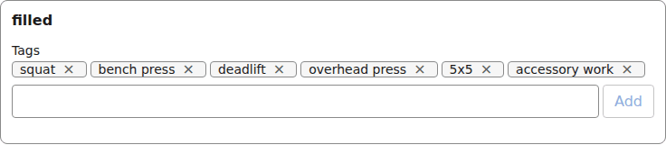
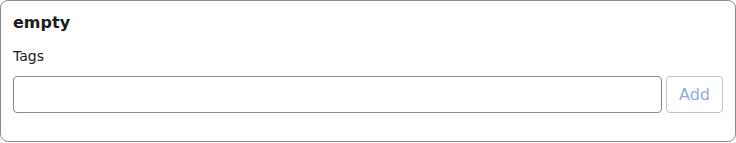
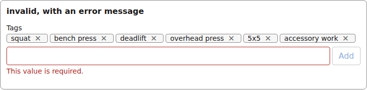
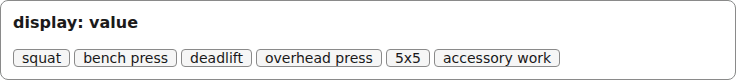
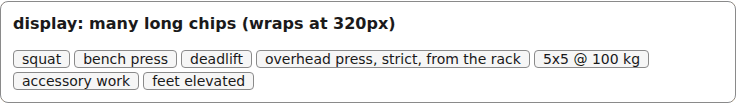
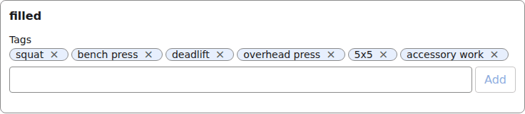

# tags

A chip editor: type and Enter adds a chip, a chip's button removes it, Backspace on the empty field removes the last.

Registry entry `fields.tags` in `registry/base.ts` pairs an `Input` with a read-only `Display`.

## Input

The renderer wraps each Input in [FieldFrame](./field-frame.md) (label, required marker, errors):

```tsx
<TagsInput
  inputId="g-x"
  field={{ id: "tags", type: "tags", label: "Tags" }}
  value={["squat", "bench press", "deadlift", "overhead press", "5x5", "accessory work"]}
  onChange={() => {}}
  invalid={false}
/>
```



*the tags input with a value (1280px, light).*

```tsx
<TagsInput
  inputId="g-x"
  field={{ id: "tags", type: "tags", label: "Tags" }}
  value={undefined}
  onChange={() => {}}
  invalid={false}
/>
```



*the tags input with no value (1280px, light).*

```tsx
<TagsInput
  inputId="g-x"
  field={{ id: "tags", type: "tags", label: "Tags" }}
  value={["squat", "bench press", "deadlift", "overhead press", "5x5", "accessory work"]}
  onChange={() => {}}
  invalid={true}
  describedBy="g-x-errors"  // only when invalid
/>
// and FieldFrame errors={[requiredError("/tags")]}
```



*the tags input with a validation error (1280px, light).*

## Display

```tsx
<TagsDisplay field={{ id: "tags", type: "tags", label: "Tags" }}
  value={["squat", "bench press", "deadlift", "overhead press", "5x5", "accessory work"]}
/>
```



*the tags Display with a value (1280px, light).*

```tsx
<TagsDisplay
  field={{ id: "tags", type: "tags", label: "Tags" }}
  value=["squat", "bench press", "deadlift", "overhead press, strict, from the rack",
           "5x5 @ 100 kg", "accessory work", "feet elevated"]
/>
```



*the tags Display with many chips, wrapped (1280px, light).*


## Theming

- `--yadad-tags-gap` — gap between parts; default: token `--yadad-space-2` (spacing scale, step 2)
- `--yadad-tags-chips-gap` — gap between chips (both the editor list and the display); default: token `--yadad-space-1` (spacing scale, step 1 (tightest))
- `--yadad-tags-chip-gap` — gap between a chip's label and its remove button; default: token `--yadad-space-1` (spacing scale, step 1 (tightest))
- `--yadad-tags-chip-padding` — chip inner padding; default: `0 var(--yadad-space-2)` (token-derived: `--yadad-space-2`)
- `--yadad-tags-font-family` — font stack; default: token `--yadad-font-family` (base font stack)
- `--yadad-tags-chip-font-size` — chip text size; default: token `--yadad-font-size-sm` (small text (labels, secondary, table cells))
- `--yadad-tags-chip-color` — chip text colour; default: token `--yadad-color-text` (main text color)
- `--yadad-tags-chip-background` — chip background; default: token `--yadad-color-surface` (raised surface (sections, panels, table headers))
- `--yadad-tags-chip-border-width` — chip border width; default: `1px`
- `--yadad-tags-chip-border` — chip border colour; default: token `--yadad-color-border` (borders and dividers)
- `--yadad-tags-chip-radius` — chip corner radius; default: token `--yadad-radius-sm` (small corner radius (inputs, buttons, chips))
- `--yadad-tags-remove-color` — chip remove-button colour; default: token `--yadad-color-text-muted` (secondary / muted text (labels, captions, empty states))
- `--yadad-tags-remove-font-size` — chip remove-button glyph size; default: token `--yadad-font-size-md` (base text (inputs, body, tab labels))
- `--yadad-tags-remove-padding` — chip remove-button padding (the glyph needs a little air to be tappable); default: `0 var(--yadad-space-1)` (token-derived: `--yadad-space-1`)
- `--yadad-tags-focus` — focus-ring color; default: token `--yadad-color-accent` (brand / primary accent — links, focus ring, selected state)
- `--yadad-tags-editor-gap` — gap between the add input and the add button; default: token `--yadad-space-1` (spacing scale, step 1 (tightest))
- `--yadad-tags-padding` — inner padding; default: `var(--yadad-space-2) var(--yadad-space-3)` (token-derived: `--yadad-space-2`, `--yadad-space-3`)
- `--yadad-tags-font-size` — font size; default: token `--yadad-font-size-md` (base text (inputs, body, tab labels))
- `--yadad-tags-color` — foreground color; default: token `--yadad-color-text` (main text color)
- `--yadad-tags-background` — background; default: token `--yadad-color-background` (page and control background)
- `--yadad-tags-border-width` — border width; default: `1px`
- `--yadad-tags-border` — border color; default: token `--yadad-color-border` (borders and dividers)
- `--yadad-tags-radius` — corner radius; default: token `--yadad-radius-sm` (small corner radius (inputs, buttons, chips))
- `--yadad-tags-border-invalid` — border color when invalid; default: token `--yadad-color-danger` (error / danger text and borders)
- `--yadad-tags-add-color` — add-button text colour; default: token `--yadad-color-accent` (brand / primary accent — links, focus ring, selected state)
- `--yadad-tags-add-disabled-opacity` — opacity of the add button while the draft is empty; default: `0.5`
- `--yadad-tags-display-color-empty` — colour of the empty marker (em-dash) in the read-only display; default: token `--yadad-color-text-muted` (secondary / muted text (labels, captions, empty states))
- `--yadad-tags-touch-font-size` — input font size under a coarse pointer; defaults to the larger of 1rem and the theme's font-size-md, so it never drops below 16px. Set it smaller only on purpose: iOS then zooms on focus; default: `var(--yadad-touch-font-size, max(var(--yadad-space-4), var(--yadad-font-size-md)))` (token-derived: `--yadad-font-size-md`, `--yadad-space-4`)
- `--yadad-tags-tap` — minimum input height under a coarse pointer (the tap target on a phone); default: `var(--yadad-touch-tap, calc(var(--yadad-space-4) * 2 + var(--yadad-space-3)))` (token-derived: `--yadad-space-3`, `--yadad-space-4`)

Before (the picture above) and after one host override. Host CSS is unlayered, so it wins over the component layer without `!important`:

```css
[data-yadad=tags] { --yadad-tags-chip-background: #e7effd; --yadad-tags-chip-radius: 999px; }
```



*the tags input after a host override of its chip variables (1280px, light).*
