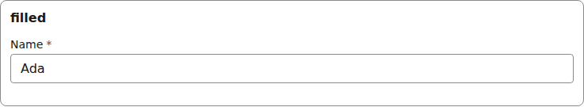
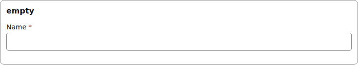
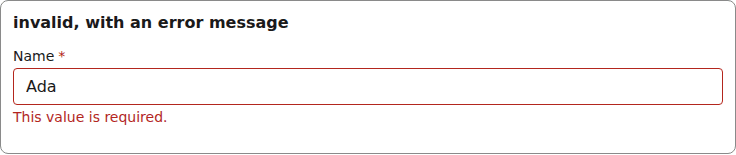
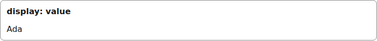
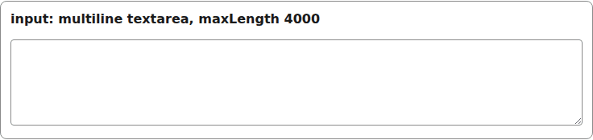
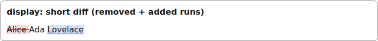
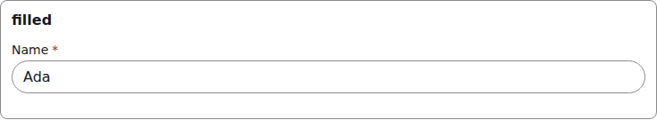

# text

A single-line text input, or a multiline `textarea` when the field is `multiline: true`. The Display can also draw word-level compare marks from a `diff` the renderer passes.

Registry entry `fields.text` in `registry/base.ts` pairs an `Input` with a read-only `Display`.

## Input

The renderer wraps each Input in [FieldFrame](./field-frame.md) (label, required marker, errors):

```tsx
<TextInput
  inputId="g-x"
  field={{ id: "name", type: "text", label: "Name", required: true }}
  value={"Ada"}
  onChange={() => {}}
  invalid={false}
/>
```



*the text input with a value (1280px, light).*

```tsx
<TextInput
  inputId="g-x"
  field={{ id: "name", type: "text", label: "Name", required: true }}
  value={undefined}
  onChange={() => {}}
  invalid={false}
/>
```



*the text input with no value (1280px, light).*

```tsx
<TextInput
  inputId="g-x"
  field={{ id: "name", type: "text", label: "Name", required: true }}
  value={"Ada"}
  onChange={() => {}}
  invalid={true}
  describedBy="g-x-errors"  // only when invalid
/>
// and FieldFrame errors={[requiredError("/name")  // { code: "required", message: "This value is required.", hint: "Enter a value." }]}
```



*the text input with a validation error (1280px, light).*

## Display

```tsx
<TextDisplay field={{ id: "name", type: "text", label: "Name", required: true }}
  value={"Ada"}
/>
```



*the text Display with a value (1280px, light).*

```tsx
<TextInput inputId="g-notes"
  field={{ ...field, multiline: true, maxLength: 4000 }}
  value="Write the note here..."
  onChange={() => {}}
  invalid={false}
/>
```



*the text input as a multiline textarea (1280px, light).*

```tsx
<TextDisplay
  field={field}
  value="Ada Lovelace"
  diff={[
    { kind: "removed", text: "Alice " },
    { kind: "same", text: "Ada " },
    { kind: "added", text: "Lovelace" },
  ]}
/>
```



*the text Display with word-level compare marks: a struck removed run, an underlined added run (1280px, light).*


## Theming

- `--yadad-text-width` — inline size; default: `100%`
- `--yadad-text-padding` — inner padding; default: `var(--yadad-space-2) var(--yadad-space-3)` (token-derived: `--yadad-space-2`, `--yadad-space-3`)
- `--yadad-text-font-family` — font stack; default: token `--yadad-font-family` (base font stack)
- `--yadad-text-font-size` — font size; default: token `--yadad-font-size-md` (base text (inputs, body, tab labels))
- `--yadad-text-color` — foreground color; default: token `--yadad-color-text` (main text color)
- `--yadad-text-background` — background; default: token `--yadad-color-background` (page and control background)
- `--yadad-text-border-width` — border width; default: `1px`
- `--yadad-text-border` — border color; default: token `--yadad-color-border` (borders and dividers)
- `--yadad-text-radius` — corner radius; default: token `--yadad-radius-sm` (small corner radius (inputs, buttons, chips))
- `--yadad-text-multiline-min-height` — minimum height of the multiline textarea (default about six lines of text); default: `calc(var(--yadad-font-size-md) * 6)` (token-derived: `--yadad-font-size-md`)
- `--yadad-text-multiline-line-height` — line height of the multiline textarea; default: `1.4`
- `--yadad-text-focus` — focus-ring color; default: token `--yadad-color-accent` (brand / primary accent — links, focus ring, selected state)
- `--yadad-text-border-invalid` — border color when invalid; default: token `--yadad-color-danger` (error / danger text and borders)
- `--yadad-text-diff-added-color` — underline colour of an added word-diff run (compare column; never the only signal); default: token `--yadad-color-accent` (brand / primary accent — links, focus ring, selected state)
- `--yadad-text-diff-added-background` — background of an added word-diff run; default: `color-mix(in srgb, var(--yadad-color-accent) 18%, transparent)` (token-derived: `--yadad-color-accent`)
- `--yadad-text-diff-removed-color` — strike-through colour of a removed word-diff run; default: token `--yadad-color-danger` (error / danger text and borders)
- `--yadad-text-diff-removed-background` — background of a removed word-diff run; default: `color-mix(in srgb, var(--yadad-color-danger) 14%, transparent)` (token-derived: `--yadad-color-danger`)
- `--yadad-text-touch-font-size` — input font size under a coarse pointer; defaults to the larger of 1rem and the theme's font-size-md, so it never drops below 16px. Set it smaller only on purpose: iOS then zooms on focus; default: `var(--yadad-touch-font-size, max(var(--yadad-space-4), var(--yadad-font-size-md)))` (token-derived: `--yadad-font-size-md`, `--yadad-space-4`)
- `--yadad-text-tap` — minimum input height under a coarse pointer (the tap target on a phone); default: `var(--yadad-touch-tap, calc(var(--yadad-space-4) * 2 + var(--yadad-space-3)))` (token-derived: `--yadad-space-3`, `--yadad-space-4`)

Before (the picture above) and after one host override. Host CSS is unlayered, so it wins over the component layer without `!important`:

```css
[data-yadad="text"][data-part="input"] { --yadad-text-radius: 999px; }
```



*the text input after a host override of its radius variables (1280px, light).*
