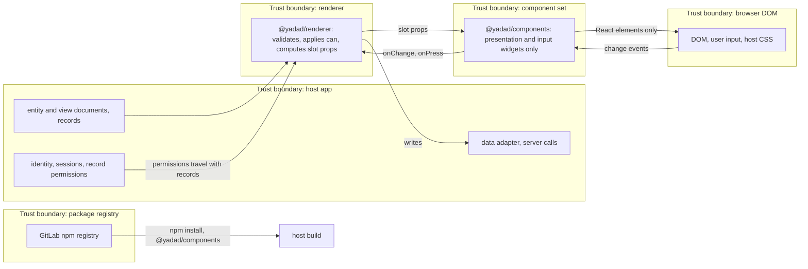
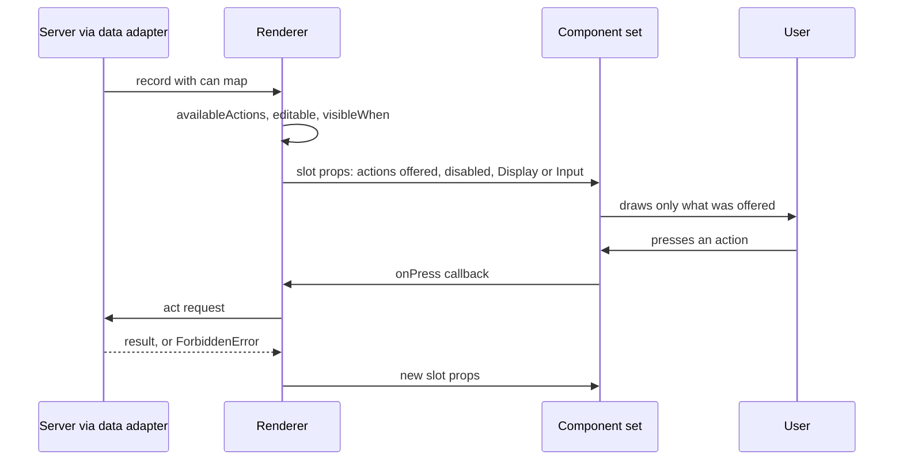
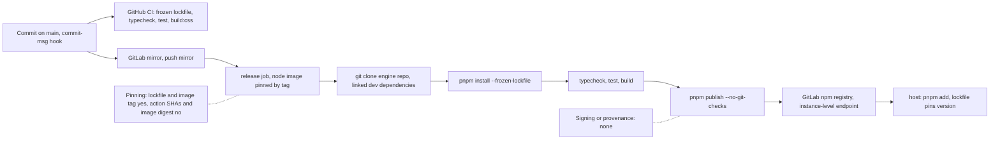

# Security

Security notes for `@yadad/components`, a library of React components. It is not a service: it has no server, no storage and no network access of its own. Everything it shows is handed to it by the renderer, and everything the user does is handed back through callbacks. Checked against commit `bbfc51e` on 2026-10-27. Structure is in [ARCHITECTURE.md](../ARCHITECTURE.md).

This file names where secrets live and never holds a value.

## 1. Trust boundaries

*The five trust boundaries and what crosses each (checked against the source and CI config at `bbfc51e`, 2026-10-27).*

The component set trusts the renderer for every value, label and permission it receives, and renders them as React text. The server behind the host remains the real authority; a UI that hides a button is a convenience, not a control.

## 2. Authorisation

The components decide nothing. A record's `can` map and the view's `visibleWhen` are resolved by the renderer (`availableActions()` in `@yadad/runtime`). The renderer withholds actions the viewer may not use and passes `disabled` for a record with an action in flight. The set only draws what it is given. The field input contract has no disabled or read-only state (see the comment in `sets/base/text/v1/Text.tsx`): a read-only field is rendered by the renderer as a `Display`.

*How a permission reaches a component: the renderer resolves it, the component only draws what it is given (checked against `Button.tsx`, `Table.tsx` and `Board.tsx` at `bbfc51e`, 2026-10-27).*

Evidence: `Button` takes `disabled` as a prop (`sets/base/button/v1/Button.tsx`); `Table` and `Board` take `pending` and render the record's actions from slot props, with the note that "the renderer hides unavailable actions" (`sets/base/board/v1/Board.tsx`). Nothing under `sets/` reads a `can` value.

## 3. Data the app holds

The component set stores nothing. `git grep` finds no `localStorage`, `sessionStorage`, cookie or IndexedDB use under `sets/` or `registry/`. Field values live in the renderer's state; drafts exist only in React state and are lost on reload.

| Data | Where it lives | Who can read it |
| --- | --- | --- |
| Record values passed in as props | In memory in the host page while rendered | The user of that page, and any script the host runs |
| Values typed into an input | In memory, then handed to the renderer through `onChange` | Same |
| Colour hints in documents | Document JSON owned by the host | Whoever can read the host's documents |

Whether any of this is personal or sensitive depends on the host's documents, which this repository cannot know. The host is responsible for its storage, retention and access rules.

## 4. Secrets inventory

The shipped package contains no secret. These are the secrets of the build and release pipeline. Names only.

| Name | Where it lives | What uses it | Rotation |
| --- | --- | --- | --- |
| `CI_JOB_TOKEN` | Injected by GitLab into each CI job | `scripts/release/publish.sh` (publish) and the `engine-range` job (read), via a `~/.npmrc` written at job start | Per job, short-lived, automatic |
| Maintainer registry token | The maintainer's local `.npmrc`, which is gitignored | Local `pnpm install` against the registry, when the instance requires one | By the maintainer in GitLab, as needed |
| GitHub push credential | The maintainer's git credential store | Pushing `main` to `origin` (GitHub and the GitLab mirror) | By the maintainer, as needed |

Rotation of the maintainer credentials is manual and has no schedule (**open**, see section 5).

## 5. Threats and mitigations

| Category | Threat | Mitigation that exists | Status |
| --- | --- | --- | --- |
| Spoofing | A package posing as `@yadad/components` | Scoped `@yadad` registry mapping; install is documented against one instance-level endpoint; the lockfile pins the resolved versions | Mitigated for hosts that use the scope mapping. **Open:** the package is published without provenance attestation, so a consumer cannot verify which commit built it |
| Spoofing | A component draws a fake permission state | Components hold no permission logic; the server decides | Mitigated |
| Tampering | A document injects markup or script through a label or value | Values render as React text; `git grep dangerouslySetInnerHTML` under `sets/` and `registry/` finds nothing (the only two uses are in `gallery/src/App.tsx`, and write the gallery's own theme CSS); no `eval`, `new Function`, `innerHTML` or link `href` under `sets/` | Mitigated |
| Tampering | A document injects CSS through a colour | Colour hints are matched against the engine palette (`paletteSlot()`); a colour outside it draws no swatch; the CSS reads tokens only, and `scripts/theming.ts` fails the test run on a hard-coded colour | Mitigated |
| Tampering | A bad release or a tampered dependency | Changesets control versions; CI runs typecheck, tests and build before publishing; `pnpm install --frozen-lockfile` in CI | Partly mitigated. **Open:** no dependency-update or vulnerability scanning is configured (no Dependabot, no audit step), and `pnpm-workspace.yaml` sets no minimum release age |
| Tampering | A compromised CI action or build image | None beyond using official actions and a Node image | **Open:** GitHub Actions are referenced by tag (`@v7`), not by commit SHA, and the CI image `node:24.21.0-bookworm` is pinned by tag, not by digest |
| Information disclosure | Data leaves through the component set | It makes no network requests (`git grep` for `fetch`, `XMLHttpRequest`, `WebSocket`, `sendBeacon` and `http` under `sets/` and `registry/` finds nothing), stores nothing, and has no analytics | Mitigated |
| Information disclosure | A secret lands in the repo or the package | `.npmrc` and `*.private.md` are gitignored; the `files` list in `package.json` ships only `dist`, `sets`, `registry`, `THEMING.md` and `CHANGELOG.md` (npm adds the README and licence) | Mitigated by convention. **Open:** no secret scanning runs in CI |
| Denial of service | Very large lists or text slow a page | Tables page through the renderer; `Skeleton` is a fixed-size placeholder; text fields honour `maxLength` | Partly mitigated. **Open:** the set does no virtualisation, so a host that passes thousands of rows to one table or board renders them all |
| Denial of service | The registry or CI is unavailable | Only publishing is affected; installed copies keep working | Accepted |
| Elevation of privilege | A user reaches an action they should not have | The renderer withholds actions; the server refuses with `ForbiddenError`; the components cannot grant anything | Mitigated here; enforcement is the server's job |
| Elevation of privilege | CI publish rights abused | The publish job runs only on pushes to the default branch and uses a per-job token | Mitigated. **Open:** there is no required review or branch protection on `main` (a deliberate owner decision while the process is minimal) |

## 6. Supply chain and deploy

*The path from commit to a host install, and where pinning and signing do and do not happen (checked against `.github/workflows/ci.yml`, `.gitlab-ci.yml` and `scripts/release/publish.sh` at `bbfc51e`, 2026-10-27).*

- The lockfile pins every dependency and CI installs with `--frozen-lockfile`. There is no signing, provenance or SBOM step.
- `@yadad/core`, `@yadad/renderer`, `@yadad/theme` and `@yadad/testing` are `link:` dev dependencies resolved from a checkout of the engine repo, which the release job clones at its default branch head. The published package therefore depends on the state of that branch for its tests. Only `@yadad/core` and `react` are peers; nothing is bundled.
- The package has no install scripts of its own beyond `prepare`, which only sets the git hooks path in a development checkout.

### Copied third-party code

`UPSTREAM.md` is the register of copied or adapted code. Today every row says "Written from scratch; nothing copied". Rule 4 in `AGENTS.md` requires any future copy to keep its upstream licence header and source link and to get a `UPSTREAM.md` row with source URL, upstream version and date. The only runtime imports are `react` and `@yadad/core`; the behaviour libraries `AGENTS.md` accepts (Radix and similar, TanStack Table and Virtual) are not used. The update path for copied code is a new `vN` folder, never an in-place edit.

## Open gaps for the owner

1. No provenance or signing on published packages.
2. No dependency or vulnerability scanning, no secret scanning, no minimum release age.
3. GitHub Actions pinned by tag and the CI image by tag, not by SHA or digest.
4. Rotation of the maintainer credentials is manual and unscheduled.
5. No virtualisation: very large lists render in full.
6. No branch protection or review on `main` (a deliberate choice for now).
7. The release job tests against the engine repo's default branch head, not a pinned engine version.
